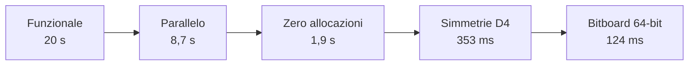

# ChessChallenge

> Esercizio TryCatchUs: posizionare pezzi di scacchi senza attacchi, ottimizzato di $690\,000\times$ (Scala, bitboard e gruppo diedrale $D_4$).

## Concetti
[[Scala]] [[CLI]]

## Panoramica
Solver Scala (repo: https://github.com/pakkio/ChessChallenge, dal 2015, ultimo aggiornamento 2025-12-31) che trova tutte le disposizioni valide di pezzi degli scacchi su una scacchiera $M \times N$ senza minacce reciproche, corredato da articolo scientifico (`article.tex` / `article.pdf`), benchmark (`PERFORMANCE_ANALYSIS.md`) ed esperimenti SAT/CNF in Python (`enhancement-ai.md`).

### Risultati verificati
- **Scacchiera $6 \times 6$**: da $24+\text{ ore}$ a **$124\text{ ms}$** ($690\,000\times$ speedup) — $2\,969$ soluzioni canoniche ($23\,752$ totali)
- **Scacchiera $7 \times 7$**: da $40+\text{ min}$ a **$1{,}1\text{ s}$** ($2\,100\times$ speedup) — $382\,990$ soluzioni canoniche

## Pipeline di ottimizzazione

## Formulazione matematica
Sfruttando le 8 isometrie del gruppo diedrale $D_4$ (4 rotazioni $\times$ 2 riflessioni) della scacchiera quadrata, lo spazio di ricerca si riduce di un fattore $|D_4| = 8$:

$$N_{\text{totali}} = |D_4| \cdot N_{\text{canoniche}} = 8 \times 2\,969 = 23\,752$$

Lo speedup complessivo rispetto alla baseline iniziale ($T_0 > 86\,400\text{ s}$) è:

$$S = \frac{T_0}{T_{\text{bitboard}}} \approx \frac{86\,400}{0.124} \approx 6.97 \times 10^5\times$$

## Tech Stack
- **Scala** (`build.sbt`, `src/`), **LaTeX** (`article.tex`), **Shell** (`benchmark-native.sh`), **CUDA** / Python SAT (`chess_problem_1463.cnf`).
- Repository: https://github.com/pakkio/ChessChallenge (pubblico, verificato 2026-11-27)
