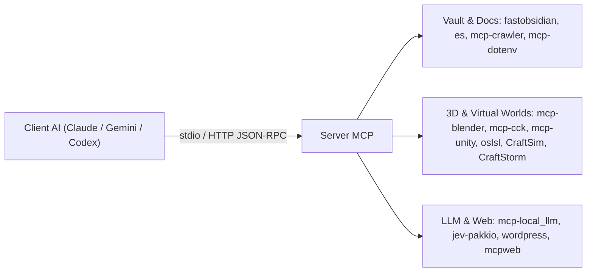

# MCP

Model Context Protocol: server e client standardizzati per collegare agenti AI (Claude, Gemini, GPT) a editor 3D, vault, database, browser, file locali e simulatori di mondi virtuali.

## Progetti collegati

- [[fastobsidian]]
- [[mcp-blender]]
- [[mcp-cck]]
- [[mcp-unity]]
- [[mcp-crawler]]
- [[mcp-dotenv]]
- [[mcp-local_llm]]
- [[mcp-wolfvoice]]
- [[mcpweb]]
- [[oslsl]]
- [[es]]
- [[wordpress]]
- [[gemini-desktop]]
- [[jev-pakkio]]
- [[cck]]
- [[CraftSim]]
- [[CraftStorm]]
