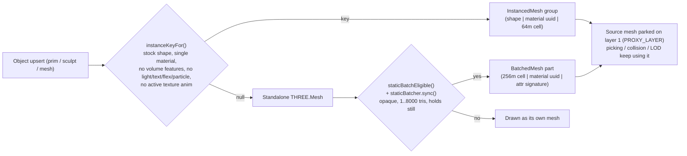

---
tags:
  - craftstorm
  - webgl
  - threejs
  - rendering
  - batching
  - bvh
  - geometry
---

# CraftStorm Web - Architecture, Rendering & Batching - Layout, coordinates and draw calls

> Part of [[CraftStorm Web - Architecture, Rendering & Batching]]. Sections: module layout, coordinate system, instancing and static batching.

## 1. Module layout

`app.js` is still a monolith (12,778 lines); the extracted, unit-testable pieces are:

| Dir / file | Role |
| :--- | :--- |
| `app.js` | scene, renderer, object upsert, cull loop, input, HUD, diagnostics |
| `collision.js`, `spatial_hash.js` | player collision (uses `intersectObjectsAccelerated`) |
| `assets/static_batch.js` (378 l) | `createStaticBatcher` (BatchedMesh batching) |
| `assets/volume_build.js` (472 l) | swept-volume prim builder (pure math) |
| `assets/sculpt_build.js` (137), `sculpt_grid.js` (13) | sculpt-map displacement, grid size |
| `assets/geo_worker.js` (41), `mesh_worker.js` (64) | off-thread sculpt/volume and mesh buffer builds |
| `assets/bvh.js` (440), `bvh_worker.js` (18), `raycast_budget.js` (60) | MeshBVH raycast acceleration |
| `assets/screen_lod.js`, `texture_lod.js`, `texture_format.js`, `idb_texture_store.js` | screen-size gate, texture LOD / wire format / IndexedDB blob store |
| `assets/anim_*.js`, `fly_speed.js`, `world_audio.js` | see [[CraftStorm Web - Avatars, Animesh, Movement & Audio]] |
| `scene/object_registry.js`, `runtime/{bridge_client,message_queue}.js`, `input/chat_commands.js`, `ui/{editor,im_panel,inventory,windows}.js`, `voice/voice_client.js` | other extracted modules (imported at `app.js:2-30`) |
| `vendor/three.module.js` + `three.core.js`, `vendor/three-mesh-bvh.module.js` | vendored libs |

Three.js is vendored at **r186** (`vendor/three.core.js:6`: `const REVISION = '186'`); `three-mesh-bvh` is `0.9.15` (`package.json`). Tests: `tests/static_batch.test.mjs`, `volume_build.test.mjs`, `sculpt_build.test.mjs`, `browser_flows.test.mjs` (raycast_budget helpers), `gpu_timer.test.mjs`, `anim_*.test.mjs`, `fly_speed.test.mjs`, `app_internals.test.mjs`, `handover_fixes.test.mjs`.

---

## 2. Coordinate system and renderer setup

### SL Z-up to Three.js Y-up (`app.js:63-64`)
```javascript
function simToThree(p) { return new THREE.Vector3(p[0], p[2], -p[1]); }
function threeToSim(v) { return [v.x, -v.z, v.y]; }
```
Quaternions and affine matrices use the same basis change in `assets/anim_clip.js` (`slQuatToThree`) and `assets/anim_frame.js` (`slAffineToThree`, similarity transform C*M*C^-1); details in the avatars note.

### Renderer (`app.js:95-135`)
- **GPU sniffing**: `GPU_RENDERER_NAME` (`app.js:97`) reads `WEBGL_debug_renderer_info` on a throwaway canvas, then calls `WEBGL_lose_context`. `WEAK_GPU` (`app.js:109`) = renderer name matches `intel|uhd|iris|mali|adreno|powervr|apple gpu|swiftshader|llvmpipe|software` AND does not match `nvidia|geforce|radeon|\barc\b`.
- **MSAA** (`app.js:115`): on if `?aa`, or (not `WEAK_GPU` and not `?noaa`). `powerPreference: 'high-performance'`.
- **Pixel ratio**: `MAX_PIXEL_RATIO = min(devicePixelRatio, WEAK_GPU ? 1.0 : 1.5)` (`:119`), `MIN_PIXEL_RATIO = WEAK_GPU ? 0.6 : 0.75` (`:120`), initial `renderPixelRatio = 0.5` regardless of GPU (`:121`) - the adaptive scaler climbs from there (see [[CraftStorm Web - Performance, Budgets & Diagnostics]]).
- **Shadows**: `shadowMap.enabled = true`, `PCFShadowMap`, `autoUpdate = false`, `SHADOW_UPDATE_EVERY = 2` (`:129`); the map is invalidated in `animate()` (`app.js:12699`: `if (sun.castShadow && frameCount % SHADOW_UPDATE_EVERY === 0) renderer.shadowMap.needsUpdate = true`). `sun.castShadow = SHADOWS_DEFAULT && !SAFE_MODE` (`:226`); `SHADOWS_DEFAULT` is true **only** when the URL has `?shadows=1` (`:86`) - shadows are OFF by default everywhere, not just on heavy regions. Shadow map size 1024 on `WEAK_GPU`, else 2048 (`:227`).
- **Output**: `SRGBColorSpace` + `ACESFilmicToneMapping` (`:130-131`); exposure replaced later by `SCENE_EXPOSURE` in the HUD block.
- **Distances**: `DRAW_DISTANCE` default 20 m from `drawDistanceInput` (`:11261`, persisted under `craftstorm-draw-distance`, `:8525`), `LOD_DISTANCE = 40` (`:11267`), `SHADOW_DISTANCE = 48` (`:11269`), `NEAR_TEXTURE_POKE_DIST = 60` (`:1602`), `MESH_ASSET_LOAD_DISTANCE = 96` (`:4396`). Escape-hatch URL flags: `?nobatch` (`:5587`), `?noinstancing` (`:5639`), `?noaa`, `?aa`, `?shadows=1`, `?triBudget=<millions>`, `?safe`.

---

## 3. Draw-call reduction: three layers



### 3.1 Layer A: unit-prim instancing (`app.js:5532-5850`)
- `INSTANCEABLE_SHAPES` (`:5567`): `box, cylinder, sphere, sphere_hemi, cone, cone_hemi, cylinder_hemi, prism, pyramid, tetrahedron`. Torus/ring/tube, tree/grass/rock and meshes are excluded (their radius is not a separable scale or they have bespoke generators).
- `instanceKeyFor(msg, shape, material)` (`:5641`) returns `null` (= no instancing) when: `?noinstancing`; `hasVolumeFeatures(...)` (cut/hollow/twist etc.); shape not instanceable; sculpt/mesh; light/text/flexible/particle; active texture animation; or `Array.isArray(material)` (per-face textures). Key = `` `${shape}|${material.uuid}|${cx},${cy}` `` where cell = `floor(pos / INSTANCE_CELL_SIZE)`, **`INSTANCE_CELL_SIZE = 64`** (`:5579`) in X/Y of SL coordinates.
- Geometry is shared unit geometry (`unitPrimGeometry`, `:5616`: 16 segments, 12 rings; box = `makeSLBoxGeometry(1,1,1)`), flagged `userData.shared = true` so dispose-guards never free it.
- Groups grow by doubling from 64 (`growInstanceGroup`, `:5655`): a new `InstancedMesh` is built, the dense live range copied, `instanceMatrix.setUsage(DynamicDrawUsage)`. `assignInstance` (`:5682`), `releaseInstance` (`:5762`) swap-removes with `_zeroMatrix`; `syncInstanceMatrices()` (`:5812`) drains `dirtyInstanceIds` and is called at the start of each cull pass (`:11508`).
- **Proxy trick**: the per-prim `Mesh` stays in `objectMeshes` with the shared unit geometry and its own `.scale`, but is parked on `PROXY_LAYER = 1` rather than `visible=false`, because an invisible parent makes three.js skip its children (non-instanced child prims). The cull loop keeps proxies `visible = true` (`:11563-11575`).
- Shadows: every group's `castShadow` is reset to false once per cull pass and re-enabled only for groups with a member within `SHADOW_DISTANCE` (`:11521`, `:11569`).

### 3.2 Layer B: region-wide static batching (`assets/static_batch.js`)
Everything instancing cannot fold (mesh assets, sculpts, cut/hollow prims, multi-face objects) is merged into `THREE.BatchedMesh` objects.
- **Constants**: `BATCH_CELL_SIZE = 256` (`static_batch.js:37`), `BATCH_MAX_TRIS = 8000` (`:40`), `KEPT_ATTRIBUTES = ['position','normal','uv']` (+ `color` when `material.vertexColors`). (The file's top comment and the `app.js:5583` comment still say "64m cell"; the code uses 256 - the comments are stale.)
- **Key** (`build()`): `` `${floor(worldX/256)},${floor(worldZ/256)}|${material.uuid}|${attributeSignature}` `` - the cell uses the three.js world matrix elements 12 and 14 (X and Z).
- **Which materials may batch** (`batchableMaterial`): `m.visible !== false && !m.transparent && m.onBeforeCompile` untouched. Only **faces** that qualify are batched, but `sync()` refuses the whole object (`hasUnbatchedFace`) if any visible face is non-batchable, so a blended face cannot vanish with its parent.
- **Which meshes may batch** (`sync`, `static_batch.js:280`): `isMesh`, not skinned / instanced / batched, geometry with `1 <= tris <= 8000`. App-side gate `staticBatchEligible` (`app.js:5593`) additionally rejects: instanced proxies, HUD/light/text/particle/flexible userData, avatars, animesh (`st.animated`), attachments (`attachPoint > 0` or avatar-parented), objects with `moveCount`, in `spinSet`/`texAnimSet`/`flexSet`, spinning (`isSpinning(st.omega)`), the currently selected object, and children whose linkset root is any of the above.
- **Sizing**: `getBatch` creates `new THREE.BatchedMesh(16, max(512, ceil(vertices*1.5)), max(1536, ceil(indices*1.5)), material)`; `addToBatch` on failure runs `optimize()` then `setGeometrySize` doubling, and instance count doubles (min 64). `castShadow/receiveShadow = true`, `sortObjects = false`, `raycast = () => {}` (picking uses source meshes).
- **Reconciliation by polling**: `syncStaticBatch(lid, mesh)` (`app.js:5610`) is called from the `finally` of **every** iteration of `updatePrimCulling()` (call at `:11647`, including `continue` branches) and calls `staticBatcher.sync(...)`. It compares geometry identity, material identity plus `transparent`/`visible` flags, world matrix (16-float compare) and effective visibility (`effectiveVisible` walks ancestors) and rebuilds (`stats.rebuilds++`) or releases. New parts are only built before `staticBatcher.setDeadline(t0 + CULL_BUDGET_MS)` (`:11503`); otherwise `stats.skippedBudget++` and the object is drawn normally. `staticBatcher.flush()` (`:11535`, `:11659`) nulls the bounding box/sphere of dirty batches. Object removal calls `staticBatcher.releaseTree` (`:6773`).
- **Layer ownership**: `park/unpark` store the original mask in a `WeakMap`; if another tool (perf probe hides objects on layer 31) changes the mask the instance is hidden without adopting that mask as the saved one (tests at `static_batch.test.mjs:285,315`).
- **Stats**: `info()` returns `{batches, objects, parts, usedVertices, reservedVertices, reservedIndices, mb, adds, rebuilds, releases, skippedBudget, failed}`; surfaced in the diag as `out.batching` (`app.js:10839`, `'off (?nobatch)'` when disabled).

### 3.3 Cutout textures and the batcher
`bridge.py` classifies decoded PNGs with alpha (`_alpha_is_mask`, `bridge.py:4405`: mask when pixels with alpha in 9..246 are at most `ALPHA_MASK_MAX_MID_FRACTION = 0.005` of all), writes a tEXt chunk `craftstorm-alpha` = `mask` and serves `Content-Type: image/png; alpha=mask` (or `alpha=blend`). The client (`markTextureOpacity`/`applyTextureAlpha`, `app.js:1679-1691`):
- JPEG/opaque: `transparent=false, alphaTest=0`
- `alpha=mask`: `transparent=false, alphaTest=0.5` (cutout; depth-writing, no sort -> **batchable**)
- other PNG alpha: `transparent=true, alphaTest=0.05` (stays unbatched; also `faceAlpha < 1` forces blending)
Because the batcher rechecks `transparent` on every sync (`signatureMatches`), a face that turns blended after its texture loads releases the object (test `static_batch.test.mjs:142`).

---

---
Back to [[CraftStorm Web - Architecture, Rendering & Batching]].
