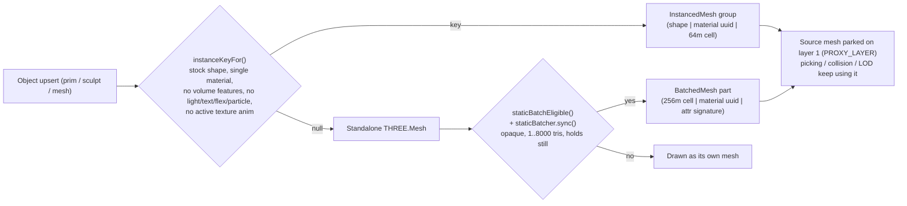

---
tags:
  - craftstorm
  - webgl
  - threejs
  - rendering
  - batching
  - bvh
  - geometry
aliases:
  - CraftStorm Rendering
  - Static Batching
  - MeshBVH
---

# CraftStorm Web - Architecture, Rendering & Batching

← Back to [[CraftStorm]] | Related: [[CraftStorm Web - Performance, Budgets & Diagnostics]], [[CraftStorm Web - Avatars, Animesh, Movement & Audio]], [[CraftStorm Bridge - LLUDP, J2K, Mesh, Anim & MCP]], [[CraftSim]]

Rendering architecture, coordinate math, procedural geometry builders, instanced/static draw-call batching and off-thread BVH raycasting of the browser viewer in `C:\Users\pakkio\w\craftstorm\web\`. Every number and `path:line` below was re-read from source; paths are relative to `web/` and line numbers refer to the checked-out `app.js` (12,778 lines).

> **Verified against code (commit `bba1a8b8f6`, 2026-10-16)**, app build string `v2.4.2 (2026-10-15)` (`app.js:37`, `package.json` version `2.4.2`). Line numbers drift on every edit; grep the symbol if a number is off.

---

## 1. Module layout

`app.js` is still a monolith (12,778 lines); the extracted, unit-testable pieces are:

| Dir / file | Role |
| :--- | :--- |
| `app.js` | scene, renderer, object upsert, cull loop, input, HUD, diagnostics |
| `collision.js`, `spatial_hash.js` | player collision (uses `intersectObjectsAccelerated`) |
| `assets/static_batch.js` (378 l) | `createStaticBatcher` (BatchedMesh batching) |
| `assets/volume_build.js` (472 l) | swept-volume prim builder (pure math) |
| `assets/sculpt_build.js` (137), `sculpt_grid.js` (13) | sculpt-map displacement, grid size |
| `assets/geo_worker.js` (41), `mesh_worker.js` (64) | off-thread sculpt/volume and mesh buffer builds |
| `assets/bvh.js` (440), `bvh_worker.js` (18), `raycast_budget.js` (60) | MeshBVH raycast acceleration |
| `assets/screen_lod.js`, `texture_lod.js`, `texture_format.js`, `idb_texture_store.js` | screen-size gate, texture LOD / wire format / IndexedDB blob store |
| `assets/anim_*.js`, `fly_speed.js`, `world_audio.js` | see [[CraftStorm Web - Avatars, Animesh, Movement & Audio]] |
| `scene/object_registry.js`, `runtime/{bridge_client,message_queue}.js`, `input/chat_commands.js`, `ui/{editor,im_panel,inventory,windows}.js`, `voice/voice_client.js` | other extracted modules (imported at `app.js:2-30`) |
| `vendor/three.module.js` + `three.core.js`, `vendor/three-mesh-bvh.module.js` | vendored libs |

Three.js is vendored at **r186** (`vendor/three.core.js:6`: `const REVISION = '186'`); `three-mesh-bvh` is `0.9.15` (`package.json`). Tests: `tests/static_batch.test.mjs`, `volume_build.test.mjs`, `sculpt_build.test.mjs`, `browser_flows.test.mjs` (raycast_budget helpers), `gpu_timer.test.mjs`, `anim_*.test.mjs`, `fly_speed.test.mjs`, `app_internals.test.mjs`, `handover_fixes.test.mjs`.

---

## 2. Coordinate system and renderer setup

### SL Z-up to Three.js Y-up (`app.js:63-64`)
```javascript
function simToThree(p) { return new THREE.Vector3(p[0], p[2], -p[1]); }
function threeToSim(v) { return [v.x, -v.z, v.y]; }
```
Quaternions and affine matrices use the same basis change in `assets/anim_clip.js` (`slQuatToThree`) and `assets/anim_frame.js` (`slAffineToThree`, similarity transform C*M*C^-1); details in the avatars note.

### Renderer (`app.js:95-135`)
- **GPU sniffing**: `GPU_RENDERER_NAME` (`app.js:97`) reads `WEBGL_debug_renderer_info` on a throwaway canvas, then calls `WEBGL_lose_context`. `WEAK_GPU` (`app.js:109`) = renderer name matches `intel|uhd|iris|mali|adreno|powervr|apple gpu|swiftshader|llvmpipe|software` AND does not match `nvidia|geforce|radeon|\barc\b`.
- **MSAA** (`app.js:115`): on if `?aa`, or (not `WEAK_GPU` and not `?noaa`). `powerPreference: 'high-performance'`.
- **Pixel ratio**: `MAX_PIXEL_RATIO = min(devicePixelRatio, WEAK_GPU ? 1.0 : 1.5)` (`:119`), `MIN_PIXEL_RATIO = WEAK_GPU ? 0.6 : 0.75` (`:120`), initial `renderPixelRatio = 0.5` regardless of GPU (`:121`) - the adaptive scaler climbs from there (see [[CraftStorm Web - Performance, Budgets & Diagnostics]]).
- **Shadows**: `shadowMap.enabled = true`, `PCFShadowMap`, `autoUpdate = false`, `SHADOW_UPDATE_EVERY = 2` (`:129`); the map is invalidated in `animate()` (`app.js:12699`: `if (sun.castShadow && frameCount % SHADOW_UPDATE_EVERY === 0) renderer.shadowMap.needsUpdate = true`). `sun.castShadow = SHADOWS_DEFAULT && !SAFE_MODE` (`:226`); `SHADOWS_DEFAULT` is true **only** when the URL has `?shadows=1` (`:86`) - shadows are OFF by default everywhere, not just on heavy regions. Shadow map size 1024 on `WEAK_GPU`, else 2048 (`:227`).
- **Output**: `SRGBColorSpace` + `ACESFilmicToneMapping` (`:130-131`); exposure replaced later by `SCENE_EXPOSURE` in the HUD block.
- **Distances**: `DRAW_DISTANCE` default 20 m from `drawDistanceInput` (`:11261`, persisted under `craftstorm-draw-distance`, `:8525`), `LOD_DISTANCE = 40` (`:11267`), `SHADOW_DISTANCE = 48` (`:11269`), `NEAR_TEXTURE_POKE_DIST = 60` (`:1602`), `MESH_ASSET_LOAD_DISTANCE = 96` (`:4396`). Escape-hatch URL flags: `?nobatch` (`:5587`), `?noinstancing` (`:5639`), `?noaa`, `?aa`, `?shadows=1`, `?triBudget=<millions>`, `?safe`.

---

## 3. Draw-call reduction: three layers



### 3.1 Layer A: unit-prim instancing (`app.js:5532-5850`)
- `INSTANCEABLE_SHAPES` (`:5567`): `box, cylinder, sphere, sphere_hemi, cone, cone_hemi, cylinder_hemi, prism, pyramid, tetrahedron`. Torus/ring/tube, tree/grass/rock and meshes are excluded (their radius is not a separable scale or they have bespoke generators).
- `instanceKeyFor(msg, shape, material)` (`:5641`) returns `null` (= no instancing) when: `?noinstancing`; `hasVolumeFeatures(...)` (cut/hollow/twist etc.); shape not instanceable; sculpt/mesh; light/text/flexible/particle; active texture animation; or `Array.isArray(material)` (per-face textures). Key = `` `${shape}|${material.uuid}|${cx},${cy}` `` where cell = `floor(pos / INSTANCE_CELL_SIZE)`, **`INSTANCE_CELL_SIZE = 64`** (`:5579`) in X/Y of SL coordinates.
- Geometry is shared unit geometry (`unitPrimGeometry`, `:5616`: 16 segments, 12 rings; box = `makeSLBoxGeometry(1,1,1)`), flagged `userData.shared = true` so dispose-guards never free it.
- Groups grow by doubling from 64 (`growInstanceGroup`, `:5655`): a new `InstancedMesh` is built, the dense live range copied, `instanceMatrix.setUsage(DynamicDrawUsage)`. `assignInstance` (`:5682`), `releaseInstance` (`:5762`) swap-removes with `_zeroMatrix`; `syncInstanceMatrices()` (`:5812`) drains `dirtyInstanceIds` and is called at the start of each cull pass (`:11508`).
- **Proxy trick**: the per-prim `Mesh` stays in `objectMeshes` with the shared unit geometry and its own `.scale`, but is parked on `PROXY_LAYER = 1` rather than `visible=false`, because an invisible parent makes three.js skip its children (non-instanced child prims). The cull loop keeps proxies `visible = true` (`:11563-11575`).
- Shadows: every group's `castShadow` is reset to false once per cull pass and re-enabled only for groups with a member within `SHADOW_DISTANCE` (`:11521`, `:11569`).

### 3.2 Layer B: region-wide static batching (`assets/static_batch.js`)
Everything instancing cannot fold (mesh assets, sculpts, cut/hollow prims, multi-face objects) is merged into `THREE.BatchedMesh` objects.
- **Constants**: `BATCH_CELL_SIZE = 256` (`static_batch.js:37`), `BATCH_MAX_TRIS = 8000` (`:40`), `KEPT_ATTRIBUTES = ['position','normal','uv']` (+ `color` when `material.vertexColors`). (The file's top comment and the `app.js:5583` comment still say "64m cell"; the code uses 256 - the comments are stale.)
- **Key** (`build()`): `` `${floor(worldX/256)},${floor(worldZ/256)}|${material.uuid}|${attributeSignature}` `` - the cell uses the three.js world matrix elements 12 and 14 (X and Z).
- **Which materials may batch** (`batchableMaterial`): `m.visible !== false && !m.transparent && m.onBeforeCompile` untouched. Only **faces** that qualify are batched, but `sync()` refuses the whole object (`hasUnbatchedFace`) if any visible face is non-batchable, so a blended face cannot vanish with its parent.
- **Which meshes may batch** (`sync`, `static_batch.js:280`): `isMesh`, not skinned / instanced / batched, geometry with `1 <= tris <= 8000`. App-side gate `staticBatchEligible` (`app.js:5593`) additionally rejects: instanced proxies, HUD/light/text/particle/flexible userData, avatars, animesh (`st.animated`), attachments (`attachPoint > 0` or avatar-parented), objects with `moveCount`, in `spinSet`/`texAnimSet`/`flexSet`, spinning (`isSpinning(st.omega)`), the currently selected object, and children whose linkset root is any of the above.
- **Sizing**: `getBatch` creates `new THREE.BatchedMesh(16, max(512, ceil(vertices*1.5)), max(1536, ceil(indices*1.5)), material)`; `addToBatch` on failure runs `optimize()` then `setGeometrySize` doubling, and instance count doubles (min 64). `castShadow/receiveShadow = true`, `sortObjects = false`, `raycast = () => {}` (picking uses source meshes).
- **Reconciliation by polling**: `syncStaticBatch(lid, mesh)` (`app.js:5610`) is called from the `finally` of **every** iteration of `updatePrimCulling()` (call at `:11647`, including `continue` branches) and calls `staticBatcher.sync(...)`. It compares geometry identity, material identity plus `transparent`/`visible` flags, world matrix (16-float compare) and effective visibility (`effectiveVisible` walks ancestors) and rebuilds (`stats.rebuilds++`) or releases. New parts are only built before `staticBatcher.setDeadline(t0 + CULL_BUDGET_MS)` (`:11503`); otherwise `stats.skippedBudget++` and the object is drawn normally. `staticBatcher.flush()` (`:11535`, `:11659`) nulls the bounding box/sphere of dirty batches. Object removal calls `staticBatcher.releaseTree` (`:6773`).
- **Layer ownership**: `park/unpark` store the original mask in a `WeakMap`; if another tool (perf probe hides objects on layer 31) changes the mask the instance is hidden without adopting that mask as the saved one (tests at `static_batch.test.mjs:285,315`).
- **Stats**: `info()` returns `{batches, objects, parts, usedVertices, reservedVertices, reservedIndices, mb, adds, rebuilds, releases, skippedBudget, failed}`; surfaced in the diag as `out.batching` (`app.js:10839`, `'off (?nobatch)'` when disabled).

### 3.3 Cutout textures and the batcher
`bridge.py` classifies decoded PNGs with alpha (`_alpha_is_mask`, `bridge.py:4405`: mask when pixels with alpha in 9..246 are at most `ALPHA_MASK_MAX_MID_FRACTION = 0.005` of all), writes a tEXt chunk `craftstorm-alpha` = `mask` and serves `Content-Type: image/png; alpha=mask` (or `alpha=blend`). The client (`markTextureOpacity`/`applyTextureAlpha`, `app.js:1679-1691`):
- JPEG/opaque: `transparent=false, alphaTest=0`
- `alpha=mask`: `transparent=false, alphaTest=0.5` (cutout; depth-writing, no sort -> **batchable**)
- other PNG alpha: `transparent=true, alphaTest=0.05` (stays unbatched; also `faceAlpha < 1` forces blending)
Because the batcher rechecks `transparent` on every sync (`signatureMatches`), a face that turns blended after its texture loads releases the object (test `static_batch.test.mjs:142`).

---

## 4. Procedural geometry

### Stock prims and SL box (`app.js:12724-12778`)
`makeSLBoxGeometry(sx, sy, sz)` takes SL axes and emits 6 faces in Linden TE order: 0 top (+Z), 1 side -Y, 2 side +X, 3 side +Y, 4 side -X, 5 bottom (-Z); `addGroup(i*6, 6, i)`. Winding is derived from `(bl-tl) x (tr-tl) . normal > 0`, not hard-coded (4 faces used to wind inward, hidden by `DoubleSide`).

### Swept volumes (`assets/volume_build.js`)
Ported from `LLProfile`/`LLPath` (`llvolume.cpp`). Key exports: `NGON_RADIUS` (`:12`), `ngonProfile` (`:14`), `profileFor` (`:40`; `profileCurve & 0x0F`: 1 square offset -0.375, 2/3/4 triangles, 5 half-circle offset 0.5 angScale 0.5, default circle), `matchRings` (`:79`, resamples outer/hole rings by union of radial angles via `rayHitPolygon` for mixed square/round hollows), `hollowProfileFor`, `buildPath`, `volumeResolution` (`:210`: `segs = 24` (12 low), circular path steps `max(6, round(24*revolutions))`, twisted 16 (8 low), else 1), `estimateVolumeTris` (`:223`, deliberate over-estimate), `buildVolumePositions` (`:234`, non-indexed triangle soup), `computeSoupNormals`, `finishVolumePositions` (`:461`).
- **Routing**: `VOLUME_WORKER_MIN_TRIS = 4000` (`app.js:5968`): below that the build is synchronous (sub-ms to few ms); above, it goes to `geo_worker.js` (`kind: 'volume'`). The comment in `geo_worker.js` header still says volume builds stay synchronous - the code in the same file (and `app.js:5974`, `:6393`) proves otherwise.

### Sculpts (`assets/sculpt_build.js`, `sculpt_grid.js`)
- `sculptGridResolution(width, height, lod)`: LOD -> 16x16; otherwise `sizeS = clamp(height, 4, 128)`, `sizeT = clamp(width, 4, 128)` (so max 128x128 = 16,384 verts).
- `sculptGridPositions`: stitching = `sculptType & 0x07` (1 sphere, 2 torus, 3 plane, 4 cylinder), flags `0x80` invert and `0x40` mirror (`reverseHorizontal` XOR logic, triangle winding reversed when `mirror !== invert`). Pixel mapping: three-X = `(R/255-0.5)*scale[0]`, three-Y = `(B/255-0.5)*scale[2]`, three-Z = `-(G/255-0.5)*scale[1]`. `computeIndexedNormals` and `boundingSphereOfPositions` live in `sculpt_build.js` (not in the worker) and the worker calls them.
- Routing: `SCULPT_WORKER_MIN_VERTICES = 2048` (`app.js:4490`); below, the build is synchronous.

### Workers (`app.js:4398-4560`)
- **`geo_worker.js`**: two jobs `kind: 'sculpt' | 'volume'`; **`GEO_WORKER_COUNT = 2`** workers, jobs distributed round-robin (`postGeoJob`, `:4504`); a dead worker is dropped and the sync path is used if all die. Result buffers are transferred zero-copy.
- **`mesh_worker.js`**: input `{faces, scale, bind, bindN}`; concatenates all faces into `pos/norm/uv/idx` (Uint16 or Uint32 when >65,535 verts), applies optional column-major 4x4 `bind` + 3x3 `bindN` (static bind-pose bake of rigged meshes) and axis swap (`sx=scale[0], sy=scale[2], sz=scale[1]`), returns `groups = [indexOffset, count, faceIndex]` and a bounding sphere.
- **Mesh asset fetch**: `GET /mesh/<uuid>?fmt=v3` (`MESH_FORMAT = 'v3'`, `app.js:~40`, must match `MESH_CACHE_VERSION` in `bridge.py`) for the full mesh, and `GET /mesh/<uuid>?fmt=v3&lod=low` (`app.js:4327`) for the distance LOD. Not `?lod=high|medium|...&v=v3` as the previous doc said.
- **Mesh LOD swap** (`updateMeshAssetLod`, `app.js:4372`, constants `:4313`): static meshes beyond `MESH_LOD_FAR = 35` m switch to the low LOD, back inside `MESH_LOD_NEAR = 28` m (hysteresis); `MESH_LOD_MAX_INFLIGHT = 4`; rigged or no-real-low-LOD meshes are recorded in `meshLowUseless`.

---

## 5. Cull pass and screen-size gating (`updatePrimCulling`, `app.js:11496-11660`)
- Timer: `CULL_INTERVAL = 0.25` s (`:11280`), doubled to 0.5 s at `shedLevel >= 1` (`:12650`). `CULL_BUDGET_MS = 3` (`:7379`); time is checked every 32 roots (`(cullCursor & 31) === 0`) and the pass resumes at `cullCursor` next frame. Keys are snapshotted in `cullKeys` at pass start.
- Per root: linkset children are forced visible (+ mesh LOD update); instanced proxies stay visible; others get `vis = dist <= DRAW_DISTANCE`, frustum test (`_cullFrustum.intersectsObject`) when childless, then the **tiny-object gate** (`estimateScreenPx`, hide below `TINY_HIDE_PX = 2`, show above `TINY_SHOW_PX = 4`, scaled by `tinyPxScale / lodFactor`, `assets/screen_lod.js`). `TRI_BUDGET = 1.5e6` default (`?triBudget=<millions>`, `:11486`): `updateTriBudget(tris)` multiplies `tinyPxScale` by 1.12 (cap 24) above budget and divides by 1.03 (floor 1) below `0.7*budget`.
- LOD for stock prims: `wantDetail = dist <= LOD_DISTANCE * lodFactor * lodSizeScale(radius) ? 'high' : 'low'`, and cylinders/spheres/trees/rocks/cones/torus/tube/ring are rebuilt via `makePrimGeometry`.
- Collision ignores `.visible`, so culling never makes walls walk-through.

---

## 6. MeshBVH raycast acceleration (`assets/bvh.js`, `bvh_worker.js`, `raycast_budget.js`)
- **Library**: `MeshBVH`, `acceleratedRaycast` from `vendor/three-mesh-bvh.module.js` (0.9.15). Options (`meshBVHOptions`, `bvh.js:95`): `{ indirect: true, targetLeafSize: BVH_MAX_LEAF_TRIS (8), maxDepth: BVH_MAX_DEPTH (32) }`.
- **Why indirect**: a non-indirect MeshBVH reorders the geometry's index buffer in place, breaking multi-material `groups` and the main thread's own index. `buildSerializedBVH(positions, index)` (`:183`) returns `serialized` including `indirectBuffer`; `attachSerializedBVH` (`:197`) attaches to the live geometry with `setIndex: false`. Fixed in commit `e4ae6cbacf`.
- **Thresholds**: `BVH_MIN_TRIS = 5000`, `BVH_MAX_TRIS = 300000` (above that: cached `null`, brute force), `BVH_MAX_HITS_PER_MESH = 32`.
- **Queue**: `queueGeometryBVH(geometry)` (`:296`) posts to `bvh_worker.js` (module worker, created lazily in `getBvhWorker`); if no Worker it falls back to the main thread, one build per `requestIdleCallback` slice (`timeout: 500`). Call sites in `app.js`: `:4279` (sculpt), `:4368` (mesh LOD 'high'), `:4929` (mesh). Stats `bvhBuildStats = {buildMs, workerMs, queued, fallback}`. The "~250 ms for 65k tris" figure is from the `bvh_worker.js` header comment (not benchmarked here: unverified).
- **Eligibility** (`bvhEligible`): only meshes whose materials are all `DoubleSide`; single-sided meshes stay on stock three.js raycast so face culling is exactly as authored.
- **`intersectObjectsAccelerated(raycaster, objects, recursive, opts)`** (`:393`): drop-in for `intersectObjects`; heavy+eligible meshes go through the BVH if built (else count a `fallback`, queue a build and brute-force that mesh), the rest through three. Used for hover/click picking (`app.js:9729, 9980, 11096`) and collision (`collision.js` `slideMove`).
- **Broadphase**: `filterPickRoots(entries, camPos, maxDist)` (`raycast_budget.js:48`, used at `app.js:11092` with `TOUCH_RANGE`) returns `null` when nothing was filtered. `collision.js` has its **own** `HEAVY_TRIANGLES = 5000` sphere gate in `collectCandidates` (XZ spatial hash, vertical slab check, then a 3D sphere gate for heavy meshes).
- **Dead exports**: `MAX_HEAVY_PER_QUERY = 8`, `isHeavyGeometry` and `distSqToSphere` in `raycast_budget.js` are only referenced by tests (`browser_flows.test.mjs`); nothing in `app.js`/`collision.js` enforces the "8 heavy meshes per collision query" cap the previous doc claimed.

---

## 7. Known gaps / unverified
- Draw-call savings figures (~12 ms for ~800 draws, 408 batches for 711 faces at 64 m) come from comments in `static_batch.js`, measured on a weak GPU; not re-measured.
- `WEBGL_multi_draw` usage is by three.js `BatchedMesh` internals; not verified in vendor code (unverified).
- Batched instances follow their source only once per cull pass (0.25 s), hence moving objects are excluded rather than synced per frame.
- Static batches are not culled per-instance by distance (only `perObjectFrustumCulled` inside BatchedMesh); `DRAW_DISTANCE` hides the source mesh through `.visible`, which `sync` propagates to the instance via `effectiveVisible`.

---

## Corrections vs previous doc
- Coordinate mapping and `WEAK_GPU` regex were right but regex also contains `software`; `renderPixelRatio` starts at 0.5 on **all** GPUs.
- Shadows are off by default **everywhere** (opt in with `?shadows=1`), not "heavy regions only".
- Static batch **grouping comment** says 64 m but the real `BATCH_CELL_SIZE` is 256; the old doc's constant was right, but it cited `L125-128`/`L132-145`/`app.js:11647` - real locations are `batchableMaterial` (`static_batch.js:125`), `getBatch` (`:132`), `syncStaticBatch` at `app.js:5610` (call site in the cull `finally`, `:11647`).
- Instancing: old doc listed "spheres, toruses" - torus is **excluded**; sphere_hemi/cone/cone_hemi/cylinder_hemi/prism/pyramid/tetrahedron are included; cell size 64 m is in X/Y of the SL position.
- Alpha-mask: the marker is a PNG tEXt chunk and Content-Type `image/png; alpha=mask`, with `alphaTest = 0.5` (not just "alphaTest"); blended PNGs get `alphaTest 0.05`.
- Volume builds are **not** always synchronous/worker-less: `geo_worker.js` handles `kind: 'volume'` for >= 4000 estimated tris; and sculpt normals come from `sculpt_build.js`, not defined inside `geo_worker.js`.
- Mesh URL is `/mesh/<id>?fmt=v3[&lod=low]`, not `?lod=high|medium|low|lowest&v=v3`.
- `MAX_HEAVY_PER_QUERY = 8` is **not applied** anywhere (dead export). Collision uses its own `HEAVY_TRIANGLES = 5000` gate.
- Old text implied `?nobatch`/`?noinstancing` did not exist; both do.
- Three.js "0.186.0" -> the vendored revision string is `'186'`.
- Line references in the old note (e.g. `app.js:11647`, `12724-12778` for both volume and box) were off or mixed; replaced above.
