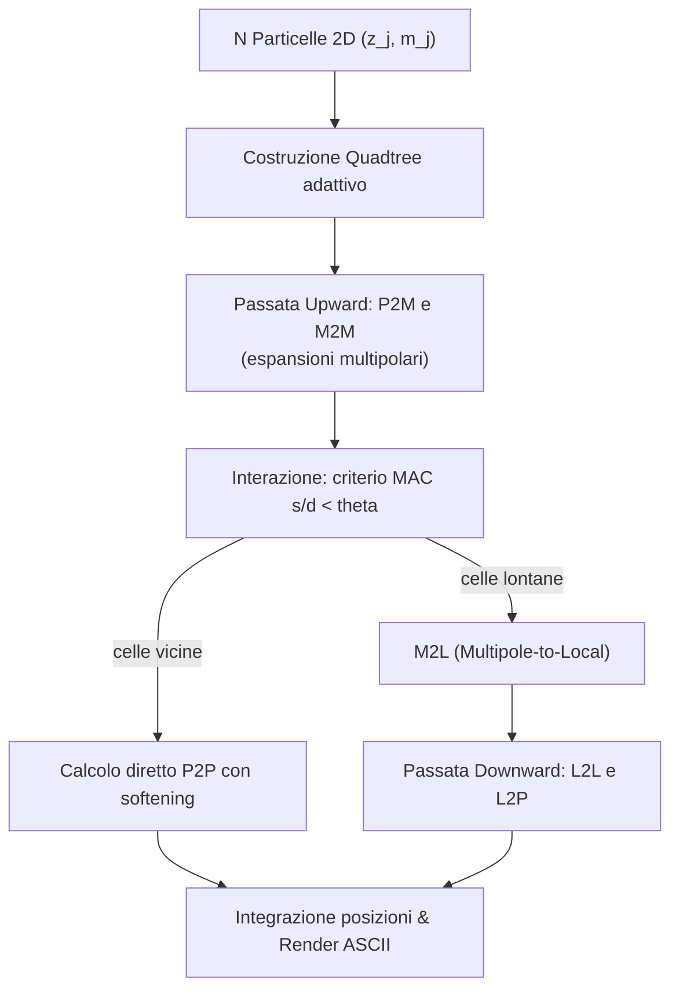

# FMM

> Fast Multipole Method in C++17: simulazione gravitazionale 2D $\mathcal{O}(N)$ con 1 milione di particelle e visualizzazione ASCII real-time.

## Concetti
[[C++]] [[CLI]] [[Python]]

## Panoramica
Implementazione C++17 senza dipendenze del **Fast Multipole Method (FMM)** per la simulazione gravitazionale 2D fino a $N = 10^6$ particelle, con visualizzazione ASCII live nel terminale, statistiche in tempo reale e script Python per il rendering video (`render_video.py`). Compilazione ottimizzata `-O3 -march=native -pthread`.

## Architettura FMM

## Formulazione matematica
Nel calcolo diretto a coppie il costo è quadratico $\mathcal{O}(N^2)$, mentre FMM raggruppa le masse lontane in espansioni multipolari nel piano complesso $z = x + i y$ raggiungendo complessità lineare $\mathcal{O}(N)$:

$$\Phi(z) = M \ln(z - z_0) + \sum_{k=1}^{p} \frac{a_k}{(z - z_0)^k}, \qquad a_k = -\frac{1}{k}\sum_{j} m_j (z_j - z_0)^k$$

Una cella di lato $s$ a distanza $d$ viene approssimata con espansione multipolare quando soddisfa il **Multipole Acceptance Criterion (MAC)**:

$$\frac{s}{d} < \theta$$

Per evitare singolarità numeriche nelle collisioni ravvicinate si introduce un parametro di softening $\varepsilon$:

$$\mathbf{a}_i = G \sum_{j \ne i} m_j \frac{\mathbf{r}_j - \mathbf{r}_i}{\left(\|\mathbf{r}_j - \mathbf{r}_i\|^2 + \varepsilon^2\right)^{3/2}}$$

## Struttura
`include/{particle,quadtree,fmm}.h`, `src/{main,fmm,quadtree}.cpp`, `CMakeLists.txt`, `Makefile`, `ALGORITHM.md`, `GUIDE.md`, `render_video.py`, `run_demo.sh`.

## Tech Stack
- C++17, CMake/Makefile, Python (`render_video.py`).
- Repository: https://github.com/pakkio/FMM (pubblico, verificato 2026-11-27)
