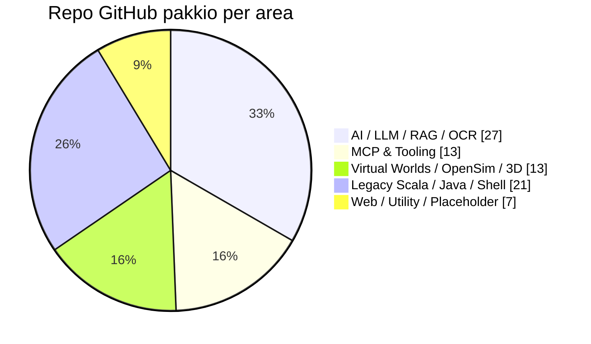

# Legacy e Fork

> Repo GitHub di pakkio storici (2015–2019), placeholder e fork di terzi, verificati su `github.com/pakkio` al 2026-11-27.

## Concetti
[[Scala]] [[Java]] [[OpenSim]] [[Virtual Worlds]] [[Database]]

## Distribuzione dei repo GitHub (`pakkio`, 81 totali)

## Repo propri storici (Scala / Java / Shell)
- `Scala2` (privato) – contenitore di test Scala (2018)
- `tmp`, `generic-scala-plugin`, `play-rest-api` (privato, Play REST) – Scala
- `akka-stream-http`, `akka-http-streams-examples` – prove Akka Stream/HTTP (2016)
- `spring-boot-h2-jpa-restserver` – server REST Spring Boot + H2 + JPA (Java, 2018)
- `spazio2.6.x` (privato, archivio Maven/Java multi-modulo: JMSHammer, connettori PeSIT/SFTP/FTPS, SPXP), `javathreads` – Java
- `restclient`, `unirestclient` – shell (2017)
- `GitInPracticeRedux` (privato), `vr`, `project`, `pluto`, `raidrive` (creato 2026-10-21, 0 file; il codice attivo del clone RaiDrive è in [[mega]]) – repo di esercizio/placeholder
- [[ChessChallenge]] – nato come esercizio Scala, poi evoluto in benchmark di ottimizzazione estrema

## Fork di terzi
- [[luanti]] – fork attivo (2026-11-21) di Luanti / Minetest (C++/Lua) con note di ottimizzazione Irrlicht
- `hifi` – High Fidelity (C++), software client/server per ambienti VR condivisi (2019)
- `lslforge` – fork aggiornato delle definizioni LSL per LSLForge (Haskell); cfr. [[oslsl]], [[lsl_simulator]]
- `quizhud` – tool educativo per Second Life/OpenSim (PHP)
- `wiki` – wiki in-game per Minetest (Lua)
- `jHardware` – dettagli hardware cross-platform (Java)
- `skeleton` – template di progetto Scala
- `logparser`, `logparse` – parser di log in Scala (ant, log4j, logback; parser combinators)
- `RxGame` – piattaforma di gioco Rx in Scala
- `edmondo-1252` – Python

## Altro
- `obsidian` – questo vault Obsidian (https://github.com/pakkio/obsidian)

## Note di verifica
- Verifica 2026-10-18: tutti i repo propri avevano ricevuto un README (tranne il fork `logparse`).
- Verifica 2026-11-27: aggiunti `raidrive` (vuoto) e il fork attivo [[luanti]]; `mega` (privato, Rust) documentato in [[mega]].
