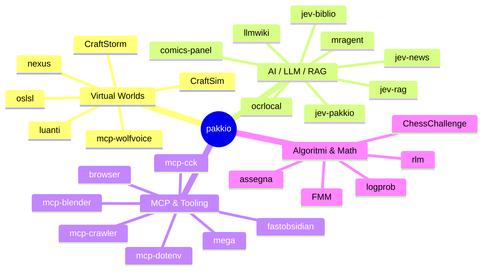

# Projects — Map of Content

Indice verificato (al 2026-11-27 contro `github.com/pakkio`, 81 repository) di tutti i progetti documentati in questo vault.

- [[agent]] — #AI_Agents #LLM #Python
- [[ainews]] — #LLM #JavaScript
- [[assegna]] — #CLI #Python #Scala #C
- [[browser]] — #JavaScript #Rust #Web
- [[cck]] — #C_Sharp #JavaScript #Python #MCP
- [[chatgroup]] — #JavaScript #LLM #Python
- [[ChessChallenge]] — #Scala #CLI
- [[claude-ext]] — #JavaScript
- [[comics-panel]] — #OCR #Python #LLM
- [[CraftSim]] — #C_Sharp #OpenSim #Python #MCP
- [[CraftStorm]] — #C++ #JavaScript #Python #Virtual_Worlds #MCP
- [[epoch]] —
- [[ernie]] — #LLM #Python
- [[es]] — #Python #MCP
- [[fastobsidian]] — #Rust #CLI #JavaScript #MCP
- [[firestormPOCJava]] — #Java #Virtual_Worlds
- [[FMM]] — #C++ #Python
- [[gemini-desktop]] — #MCP #TypeScript
- [[gemma3-270M-finetuning-ner]] — #LLM #Python
- [[gemmafunction]] — #LLM #Python
- [[Gen]] — #C_Sharp
- [[googlelivetranslate]] — #Python
- [[jev-biblio]] — #LLM #Python
- [[jev-news]] — #LLM #Python
- [[jev-pakkio]] — #LLM #Python #MCP
- [[jev-rag]] — #Database #LLM #Python #RAG
- [[jevrouter]] — #LLM
- [[Legacy e Fork]] — #Scala #Java
- [[libopenmetaverse]] — #C_Sharp #C++
- [[libremetaverse]] — #C_Sharp
- [[llmrag]] — #RAG #Python
- [[llmwiki1]] — #LLM #TypeScript
- [[llmwiki]] — #TypeScript #Python #LLM
- [[local_llm]] — #C++ #LLM #Python
- [[logprob]] — #LLM #Python
- [[lsl_simulator]] — #Python #OpenSim
- [[luanti]] — #C++ #Virtual_Worlds
- [[marker1]] — #OCR #Python
- [[mcp-blender]] — #Go #Python #Blender #MCP
- [[mcp-cck]] — #C_Sharp #TypeScript #MCP #Unity
- [[mcp-crawler]] — #MCP #JavaScript
- [[mcp-dotenv]] — #MCP #JavaScript
- [[mcp-local_llm]] — #MCP #LLM #JavaScript
- [[mcp-unity]] — #C_Sharp #JavaScript #MCP #Unity
- [[mcp-wolfvoice]] — #Rust #MCP #OpenSim #Virtual_Worlds
- [[mcpweb]] — #MCP #Web
- [[mega]] — #Rust #CLI
- [[MegaFuse]] — #C++
- [[mondovirtuale]] — #Virtual_Worlds #Python #Web
- [[mragent-backup]] — #AI_Agents #Database #LLM
- [[mragent]] — #AI_Agents #Database #LLM #RAG #Python
- [[MSA]] — #Python
- [[ne4j]] — #Database #Python #RAG
- [[nexus-narrative-weaver]] — #TypeScript #AI_Agents
- [[nexus2]] — #AI_Agents #Python #OpenSim
- [[nexus]] — #AI_Agents #JavaScript #Python #OpenSim
- [[nispa-ocr]] — #JavaScript #OCR #Python
- [[ocr]] — #OCR #Python #LLM
- [[ocrlocal]] — #OCR #Python #LLM
- [[openrouter]] —
- [[opensim-baseline]] — #C_Sharp #OpenSim #Virtual_Worlds
- [[opensim-cpp]] — #C++ #OpenSim #Python
- [[oslsl]] — #MCP #TypeScript #OpenSim
- [[pak]] — #CLI #LLM #Python
- [[pakagent]] — #AI_Agents #CLI #Python
- [[phoenix-firestorm]] — #Virtual_Worlds #C++
- [[pk]] — #JavaScript #Web
- [[ppd]] — #OpenSim #AI_Agents #Python
- [[processor]] —
- [[pythonery]] — #Python
- [[rlm]] — #CLI #LLM #Python
- [[schoolsafe]] — #Web
- [[search]] — #CLI #Python
- [[skills]] — #AI_Agents #LLM #Python
- [[soup-pakkio]] — #Python #RAG #LLM
- [[spirale]] — #C++ #CLI #Python
- [[subq]] — #Python
- [[subs]] — #CLI #JavaScript #Python
- [[summary]] — #JavaScript #LLM
- [[tbi]] — #CLI #Python
- [[vibevoice]] — #LLM #Python
- [[wordpress]] — #MCP #Web #JavaScript #Python
- [[youtube-news]] — #LLM #Python

## Concetti
- [[Concepts/Rust|Rust]]
- [[Concepts/Go|Go]]
- [[Concepts/Python|Python]]
- [[Concepts/C Sharp|C Sharp]]
- [[Concepts/C++|C++]]
- [[Concepts/Scala|Scala]]
- [[Concepts/Java|Java]]
- [[Concepts/TypeScript|TypeScript]]
- [[Concepts/JavaScript|JavaScript]]
- [[Concepts/Unity|Unity]]
- [[Concepts/Blender|Blender]]
- [[Concepts/OpenSim|OpenSim]]
- [[Concepts/LLM|LLM]]
- [[Concepts/RAG|RAG]]
- [[Concepts/OCR|OCR]]
- [[Concepts/Web|Web]]
- [[Concepts/CLI|CLI]]
- [[Concepts/Database|Database]]
- [[Concepts/Virtual Worlds|Virtual Worlds]]
- [[Concepts/MCP|MCP]]
- [[Concepts/AI Agents|AI Agents]]
