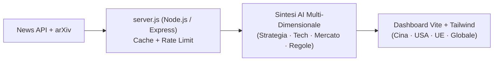

# ainews

> Piattaforma web di intelligence AI in tempo reale (`v2.3.0`): aggregazione News API + arXiv, sintesi multi-dimensionale (strategica, tecnica, mercato, regolatoria) e analisi geopolitica Cina/USA/UE.

## Concetti
[[LLM]] [[JavaScript]] [[Web]]

## Panoramica
Aggrega notizie in tempo reale da News API e paper **arXiv**, sintetizzandole con LLM in output Markdown strutturati con confidence scoring e validazione delle fonti (rimossi tutti i mock data in `85b0aaa`). Copre le dinamiche geopolitiche Cina/USA/UE/globale in una dashboard a tab con caching e rate limiting.

## Tech Stack
- Node.js / Express (`server.js`), Vite, Tailwind CSS, vanilla JS.
- Repository: https://github.com/pakkio/ainews (pubblico, verificato 2026-11-27)

## Collegamenti
[[youtube-news]], [[jev-news]]
