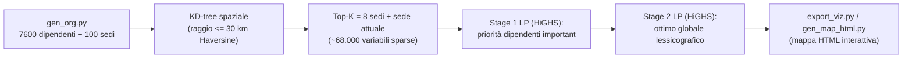

# assegna

> Toolkit di matching e riassegnazione ottimale personale–sedi (~7.600 persone × 100 sedi in ~2 s) con KD-tree, distanza Haversine (cap 30 km) e programmazione lineare esatta (HiGHS), benchmarkato in Python, C e Scala.

## Concetti
[[CLI]] [[Python]] [[Scala]]

## Pipeline di riassegnazione ottimale



## Formulazione matematica
La distanza geodetica tra due coordinate $(\phi_1, \lambda_1)$ e $(\phi_2, \lambda_2)$ sulla sfera terrestre ($R \approx 6371\text{ km}$) usa la formula di **Haversine**:

$$d = 2 R \arcsin\!\sqrt{\sin^2\!\left(\frac{\phi_2 - \phi_1}{2}\right) + \cos\phi_1 \cos\phi_2 \sin^2\!\left(\frac{\lambda_2 - \lambda_1}{2}\right)}$$

Poiché la matrice dei vincoli del problema di trasporto bipartito è **totalmente unimodulare**, il rilassamento continuo $x_{ij} \in [0, 1]$ ha vertici ottimi automaticamente interi $\{0, 1\}$ (nessun MILP necessario):

$$\max \sum_{i} \sum_{j \in \mathcal{N}_K(i)} w_{ij}\, x_{ij} \quad \text{s.t.} \quad \sum_{j \in \mathcal{N}_K(i)} x_{ij} = 1\;\;\forall i, \quad \sum_{i} x_{ij} \le c_j\;\;\forall j, \quad 0 \le x_{ij} \le 1$$

## Panoramica
# assegna

Workforce-to-place matching and reassignment toolkit.

## Files

- `chat.py` -- simple terminal chat against the OpenCode Go LLM gateway.
- `match.py` -- capability-based matching between `users.json` and `places.json`,
  with a 30km relocation cap and exact LP-based optimal assignment.
- `gen_org.py` -- generates synthetic org data: 100 places anchored to real cities
  across 5 continents, ~7600 existing employees (tagged A/B/C mobility tiers, plus
  `protected_category` / `dependents` / `allow_relocating` / `busy` fields, and a
  quantized `capabilities` proficiency level per skill -- see "Quantized skill
  levels" below), 200 new candidate CVs. Every generated point is validated on-land
  (point-in-polygon against real country boundaries) so nothing lands in the sea or
  an empty desert.
- `reassign.py` -- solves the reassignment as one joint linear program (see
  "Strategy" below), with an optional two-stage lexicographic priority pass for
  employees flagged `important` (see "Priority employees" below).
- `export_viz.py` / `gen_map_html.py` / `build_world_paths.py` -- re-run the
  pipeline and render an interactive relocation map (real country outlines,
  proportional arrows) as a self-contained HTML file.
- `bench_haversine.c` / `BenchHaversine.scala` / `bench_haversine.py` -- identical
  dense-distance-matrix benchmark in three languages, isolating how much of
  `reassign.py`'s runtime is "the language" vs. "the algorithm" (see "Language vs.
  algorithm" below).
- `bench_kdtree.c` / `BenchKdtree.scala` / `bench_kdtree.py` -- the same benchmark
  in the same three languages, but using a KD-tree instead of a dense loop -- the
  actual fix now implemented in `reassign.py`'s `combined_score_matrix`.

Run any script with `uv run <script>.py` (each is a self-contained `uv` script
with inline dependencies). `chat.py` and any `--llm` matching paths expect
`OPENCODEGO_API_KEY` in a `.env` file one directory up.

## Strategy: why this is fast *and* exact, not a heuristic

The short answer for "why does this run in ~2 seconds over 7600 people x 100
places" is: **it's a linear program, not a search.** No trial-and-error, no
greedy pass, no branch-and-bound. `scipy.optimize.linprog` (HiGHS) solves it
directly to a provable optimum in one shot. Two properties make that possible:

### 1. The core problem is a transportation problem, not a general assignment problem

Assigning people to places under capacity limits is a classic **transportation
problem** (bipartite b-matching with capacities). Its constraint matrix is
[totally unimodular](https://en.wikipedia.org/wiki/Unimodular_matrix#Totally_unimodular_matrices),
which means the *linear relaxation* (letting each assignment variable be any
value in `[0, 1]` instead of forcing it to exactly 0 or 1) already has an
integral optimal vertex. So there is no need for a MILP solver with
branch-and-bound -- plain LP already gives a 0/1 answer.

This is why we deliberately do **not** use a greedy heuristic (sort by score,
assign what's left). Early in this project a greedy version was tried and
measurably wrong: a 2-person/2-place counterexample found total score 11
against a true optimum of 18. The LP formulation doesn't have that failure
mode -- it's exact by construction, not "usually good enough."

### 2. Every person only sees their top-K candidate places, not all 100

Nobody realistically evaluates every place in the world before considering a
move. Each person's LP variables are restricted to their top-K
(`TOP_K = 8`) best-scoring destinations plus their own current place (always
offered, so "stay" is always feasible). This keeps the LP sparse: instead of
~7600 x 100 = 760,000 variables, there are on the order of 7600 x 9 ≈ 68,000 --
small enough that HiGHS solves it in about a second, and it doubles as a
realism constraint (bounded relocation search radius), not just a performance
trick.

### The mobility rule, and why it's still one LP and not a MILP

- **A, B, C mobility tiers**, `protected_category`, `dependents`, `allow_relocating`, `busy` e livelli di competenza quantizzati vengono codificati direttamente nell'insieme ammissibile $\mathcal{N}_K(i)$ e nei pesi $w_{ij}$; i dipendenti prioritari sono gestiti con una doppia passata LP lessicografica (commit `1ee8108` / `873f918`). La logica di matching è verificata con copertura test in Python, C e Scala (`4c0c17f`).

## Tech Stack
- Linguaggi: Python (12), Scala (5)
- File totali (scan): 217
- Estensioni principali: .class=48, (noext)=36, .cmake=14, .py=12, .make=10, .c=9, .txt=9, .gcov=8
- Remote: `git@github.com:pakkio/assegna.git`

## Struttura (top-level)
```
BenchHaversine.scala
BenchKdtree.scala
CMakeLists.txt
Match.scala
README.md
TestMatchScala.scala
TestScala.scala
__pycache__
a-bench_haversine.gcda
a-bench_haversine.gcno
a.out
bench_haversine.c
bench_haversine.c.gcov
bench_haversine.py
bench_haversine_c
bench_haversine_c-bench_haversine.gcda
bench_haversine_c-bench_haversine.gcno
bench_kdtree.c
bench_kdtree.c.gcov
bench_kdtree.py
bench_kdtree_c
build
build.sbt
build_world_paths.py
chat.py
export_viz.py
gen_map_html.py
gen_org.py
hello
hello.c
match.c
match.py
match2
out
places.json
project
reassign.py
target
test_bench_kdtree
test_bench_kdtree.c
```

## Documentazione presente nel repo
- `.pytest_cache/README.md`
- `README.md`

## Progetti correlati
- [[rlm]]
- [[search]]
- [[spirale]]
- [[subs]]
- [[tbi]]

## Link
- Repository: git@github.com:pakkio/assegna.git
- Path locale: `/home/pakkio/w/assegna`
