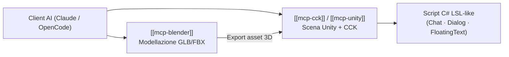

# cck

> Script C# per ChilloutVR (CCK / Unity) che replicano le chiamate LSL di Second Life, più tooling MCP per pilotare Blender e Unity da agenti AI.

## Concetti
[[C Sharp]] [[JavaScript]] [[Python]] [[TypeScript]] [[Unity]] [[MCP]]

## Equivalenti LSL per Unity / CCK

| Script C# | Equivalente LSL | Guida |
|---|---|---|
| `CckChatLogger.cs` | `llSay`, `llInstantMessage` | `README_cck_chat.md` |
| `CckChatListener.cs` | `llListen` | `README_cck_chat_listener.md` |
| `CckDialog.cs`, `CckDialogLightToggle.cs` | `llDialog` | `README_cck_dialog.md` |
| `CckFloatingText.cs`, `CckFloatingTextExample.cs` | `llSetText` | `README_cck_floatingtext.md` |

## Pipeline MCP Blender + Unity



## Panoramica
Toolkit Unity per mondi ChilloutVR (`CCK_4.0.1_Release.unitypackage`) più pipeline locale MCP (`mcp-pipeline/`, `mcp-unity-server/`, `skills/`). Repo: https://github.com/pakkio/cck (verificato 2026-11-27).

## Tech Stack
- Linguaggi: TypeScript (78), JavaScript (78), Python (7), C# (6)
- File totali (scan): 190
- Estensioni principali: .ts=78, .js=78, .md=8, .py=7, .cs=6, .json=5, (noext)=3, .unitypackage=2
- Remote: `git@github.com:pakkio/cck.git`

## Struttura (top-level)
```
CCK_4.0.1_Release.unitypackage
CckChatListener.cs
CckChatLogger.cs
CckDialog.cs
CckDialogLightToggle.cs
CckFloatingText.cs
CckFloatingTextExample.cs
LICENSE
MCP_BLENDER_UNITY_PROMPTS_ACTIVITY.md
README_cck_chat.md
README_cck_chat_listener.md
README_cck_dialog.md
README_cck_floatingtext.md
SETUP.md
mcp-pipeline
mcp-unity-server
mcp_bridge-2.3.4.zip
opencode.json
pakkio.unitypackage
skills
```

## Documentazione presente nel repo
- `MCP_BLENDER_UNITY_PROMPTS_ACTIVITY.md`
- `README_cck_chat.md`
- `README_cck_chat_listener.md`
- `README_cck_dialog.md`
- `README_cck_floatingtext.md`
- `SETUP.md`
- `skills/unity-python-bridge-patterns.md`

## Progetti correlati
- [[Gen]]
- [[craftsim]]
- [[libopenmetaverse]]
- [[libremetaverse]]
- [[llmwiki]]
- [[llmwiki1]]
- [[mcp-blender]]
- [[mcp-unity]]
- [[nispa-ocr]]
- [[opensim-baseline]]
- [[opensim-cpp]]

## Link
- Repository: git@github.com:pakkio/cck.git
- Path locale: `/home/pakkio/w/cck`
