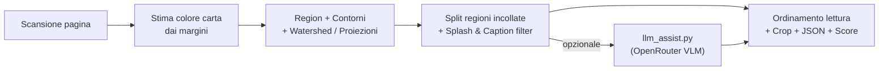

# comics-panel

> Rilevamento ed estrazione di vignette in pagine di fumetti scansionate: computer vision classica (region, watershed, griglia) con assist opzionale OpenRouter LLM e benchmark.

## Concetti
[[Python]] [[OCR]] [[LLM]]

## Panoramica
Rileva e ritaglia le singole vignette da scansioni di fumetti (`panel_detector.py`), combinando strategie classiche senza deep learning con un livello opzionale di assistenza LLM vision (`llm_assist.py`) e valutazione automatica (`score_panels.py`).

### Aggiornamenti recenti (2026-11-26)
- **Region method** (strategia primaria): stima il colore della carta dai margini della pagina e tratta le aree non-carta come candidate, gestendo bordi deboli, colorati o assenti.
- **Strategie complementari**: analisi dei contorni, segmentazione watershed e fallback a griglia basato su proiezioni.
- **Gestione layout complessi**: splash panel, suddivisione di regioni incollate (*glued-region splitting*), filtro delle didascalie (*caption filter*), de-duplicazione e ordinamento di lettura.
- **Assist LLM opzionale (`llm_assist.py`)**: proposte/raffinamento di pannelli difficili via OpenRouter + pagina di benchmark (`score_panels.py`).

## Pipeline di estrazione

## Metrica di valutazione (`score_panels.py`)
Il matching tra vignette predette $B_p$ e ground truth $B_g$ usa l'Intersection over Union:

$$\mathrm{IoU}(B_p, B_g) = \frac{|B_p \cap B_g|}{|B_p \cup B_g|}$$

## Struttura
`panel_detector.py`, `llm_assist.py`, `score_panels.py`, `data/`, `tests/`, `requirements.txt`, `README.md`.

## Tech Stack
- Python, OpenCV, NumPy, SciPy, scikit-image, OpenRouter API (opzionale).
- Repository: https://github.com/pakkio/comics-panel (pubblico, ultimo push 2026-11-26)

## Collegamenti
[[ocrlocal]], [[ocr]], [[browser]]
