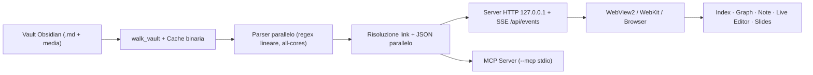

# fastobsidian

> Explorer ed editor nativo in Rust per vault Obsidian: 40.000 note aperte in ~0,2 s, un singolo eseguibile da ~3,9 MB, server MCP integrato, editor live, Mermaid, LaTeX e Slides offline.

## Concetti
[[Rust]] [[CLI]] [[JavaScript]] [[MCP]]

## Panoramica
**fastobsidian** (v1.3.0, repo: https://github.com/pakkio/fastobsidian) è un'applicazione nativa scritta in **Rust** (la precedente implementazione Python `obsidian_explorer.py` è stata rimossa dalla v1.2.0) che apre qualsiasi vault Obsidian in una finestra nativa basata sulla webview di sistema (**WebView2** su Windows, **WebKit** su macOS e Linux), senza Electron e senza chiamate di rete.

Lo stesso binario singolo copre quattro modalità:
- **Finestra nativa** (default): apre la vault con splash progressivo mostrato solo se il caricamento supera 600 ms.
- **`--serve`**: server HTTP locale su `127.0.0.1:8765` per qualsiasi browser.
- **`-o explorer.html`**: esportazione statica autonoma in sola lettura.
- **`--mcp`**: server MCP su stdio per agenti AI (`search`, `read`, `write`, `index`, `backlinks`, `rename`, `delete`).

## Architettura



## Funzioni principali
- **Indice e cache su disco**: parsing multi-core con regex lineari, risoluzione link e serializzazione JSON parallele, cache binaria per vault (`%LOCALAPPDATA%\fastobsidian\index-cache`).
- **Rendering ricco offline (zero dipendenze)**:
  - Markdown completo, `[[wikilink]]` (con alias e `#heading`), link relativi `.md`, embed di note (fino a 2 livelli), immagini/audio/video/PDF, callout e TOC.
  - **Mermaid nativo SVG**: `flowchart`/`graph`, `sequenceDiagram`, `stateDiagram-v2`, `pie`, `classDiagram`, `erDiagram`, `mindmap` (con fallback sicuro a blocco codice).
  - **LaTeX nativo MathML**: formule inline `$...$` e a blocco `$$...$$` (frazioni, radici, matrici, `cases`, operatori con limiti, simboli greci).
  - **Slides (`Alt+P`)**: presentazione a schermo intero divisa su `---` con supporto a immagini, Mermaid e LaTeX.
- **Editor live quasi-WYSIWYG** (con toggle `Live / Source`): ogni blocco è renderizzato e si trasforma in markdown al click; continuazione liste/task/quote/tabelle, anteprima live sotto il codice per Mermaid e LaTeX, pulsante **Today's note (`Alt+D`)**, incolla/drag-and-drop immagini nella cartella allegati Obsidian.
- **Grafo interattivo**: simulazione force-directed con Barnes-Hut $O(N \log N)$, clustering per label propagation, focus 1–3 hop, nodi ghost per link non risolti.
- **Temi Obsidian (`--theme`)** e live refresh entro ~1 s tramite SSE (`/api/events`).

## Prestazioni e modello di costo
Su una vault di $N = 40\,000$ note (~2 KB e ~40 link ciascuna, Windows 11 16 thread, build release):

| Avvio | Tempo indicizzazione | Speedup vs v1.0.0 |
|---|---:|---:|
| v1.0.0 (fancy-regex single-thread) | $8.2\text{ s}$ | $1\times$ |
| v1.1+ primo avvio (parallelo, tutti i core) | $0.9\text{ s}$ | $9.1\times$ |
| v1.1+ avvii successivi (cache su disco) | $0.2\text{ s}$ | $41\times$ |

Il tempo di avvio con cache scala solo sulle note modificate ($k \ll N$):
$$T_{\text{start}}(N, k) = T_{\text{walk}}(N) + T_{\text{cache}}(N) + \frac{k}{p}\,T_{\text{parse}} + \frac{T_{\text{resolve}}(N)}{p}$$
e la repulsione nel grafo utilizza un quadtree Barnes-Hut con soglia $\theta = 0.9$ ($\theta^2 = 0.81$):
$$F_{\text{rep}} = K\,\frac{q_i\,m_j}{d^2 + (r_i + r_j)^2}\,\alpha, \qquad \mathcal{O}(N \log N)$$

## Uso
```bash
fastobsidian /percorso/vault               # finestra nativa
fastobsidian /percorso/vault --serve       # server locale http://127.0.0.1:8765/
fastobsidian /percorso/vault -o out.html   # pagina statica sola lettura
fastobsidian /percorso/vault --mcp         # server MCP su stdio
```
Opzioni: `--theme`, `--no-cache`, `--watch SECONDS`, `--port N`, `-o FILE`, `--version`.

## Sicurezza e affidabilità
- Ascolta solo su `127.0.0.1` con controllo `Host`/`Origin` e header `X-Explorer: 1` sulle scritture; non segue symlink/junction; rifiuta note > 32 MiB (`MAX_NOTE_BYTES`).
- Eliminazione recuperabile in `<vault>/.trash/`; il rename aggiorna sia `[[wikilink]]` sia link markdown `[testo](x.md)` preservando i fine riga; controllo conflitti `mtime` al salvataggio.
- CI su Windows, macOS e Linux: `cargo test` (27 test), Playwright E2E (17 test su Chromium e WebKit), avvio e screenshot della finestra reale su tutti e tre i sistemi.

## Struttura (top-level)
```text
src/main.rs, src/gui.rs     CLI, finestra nativa, splash progressivo
src/vault.rs, src/cache.rs  parser lineare, indice parallelo, cache binaria
src/ops.rs, src/daily.rs    operazioni sicure, link-rewrite, daily note e allegati
src/server.rs, src/page.rs  server HTTP/1.1 + SSE, template HTML e temi Obsidian
src/mcp.rs                  server MCP JSON-RPC su stdio
src/icon.rs, build.rs       icona generata via codice e risorsa .exe Windows
explorer_template.html      UI completa (Index, Graph, Note, Live Editor, Mermaid, LaTeX, Slides)
splash.html                 schermata di caricamento compatta
tests/, e2e/                test Rust e test browser Playwright
```

## Link
- Repository: https://github.com/pakkio/fastobsidian
- Ultima release: `v1.3.0` (2026-11-27)
- Path locale: `C:\Users\claud\w\fastobsidian`
