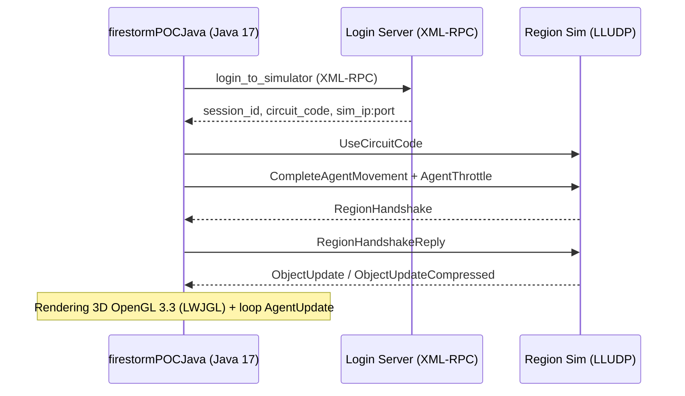

# firestormPOCJava

> Proof of Concept didattico in Java 17 di un viewer Second Life / OpenSim con login XML-RPC, handshake LLUDP e rendering 3D LWJGL/OpenGL 3.3, ispirato all'architettura C++ di Firestorm.

## Concetti
[[Java]] [[Virtual Worlds]] [[OpenSim]]

## Panoramica
Implementazione Java (repo: https://github.com/pakkio/firestormPOCJava) che riproduce fedelmente l'architettura modulare del viewer C++ Firestorm:
- **Login XML-RPC** verso grid Second Life (Agni/Aditi) e OpenSim.
- **Handshake LLUDP completo**: `UseCircuitCode`, `CompleteAgentMovement`, `AgentThrottle`, `RegionHandshake`, keep-alive con ping e `AgentUpdate`.
- **Streaming oggetti**: decodifica `ObjectUpdate` / `ObjectUpdateCompressed`.
- **Rendering 3D & UI**: LWJGL / OpenGL 3.3 (terreno, oggetti, LOD, frustum culling), movimento WASD, UI Swing con mappa 2D.
- **Pacchetti**: `agent`, `core` (`LLVector3`, `LLQuaternion`, `LLUUID`, `LLColor4`), `login`, `network` (`LLCircuit`, `LLByteReader/Writer`).

## Sequenza di connessione al grid

## Tech Stack
- Java 17, Maven (`pom.xml`), LWJGL / OpenGL 3.3, Swing, script installazione PowerShell.
- Repository: https://github.com/pakkio/firestormPOCJava (pubblico, verificato 2026-11-27)

## Collegamenti
[[phoenix-firestorm]], [[opensim-cpp]], [[libopenmetaverse]], [[CraftStorm]]
