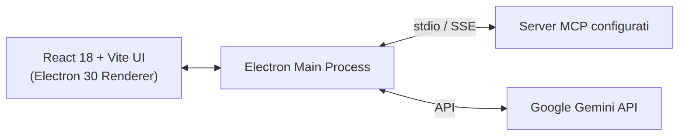

# gemini-desktop

> Client desktop Electron + React + TypeScript per collegare server MCP all'API Google Gemini.

## Concetti
[[MCP]] [[LLM]] [[TypeScript]] [[JavaScript]]

## Panoramica
Applicazione desktop (repo: https://github.com/pakkio/gemini-desktop) basata su **Electron 30**, **Vite 5**, **React 18** e **TypeScript** che funge da host grafico per server MCP usando Google Gemini come backend conversazionale. La compatibilità dei server testati è documentata in `mcpServerTested.md`.

## Tech Stack
- TypeScript, React 18, Electron 30, Vite, `electron-builder`.
- Repository: https://github.com/pakkio/gemini-desktop (pubblico, verificato 2026-11-27)

## Collegamenti
[[MCP]], [[mcp-blender]], [[mcp-cck]], [[oslsl]]
