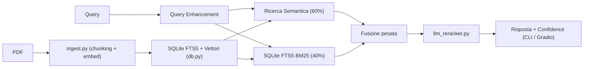

# llmrag

> Sistema RAG su PDF con ricerca ibrida (60% semantica OpenAI + 40% SQLite FTS5 BM25), reranking LLM, query enhancement adattivo e confidence a semaforo.

## Concetti
[[RAG]] [[LLM]] [[Database]] [[Python]]

## Panoramica
Pipeline RAG completa (repo: https://github.com/pakkio/llmrag) per l'indicizzazione e l'interrogazione di documenti PDF con:
- **Ricerca ibrida configurabile**: embeddings semantici (`text-embedding-3-large`) + keyword matching su **SQLite FTS5** (BM25), pesi di default $60\% / 40\%$.
- **Reranking LLM** (`llm_reranker.py`, es. Gemini 2.0 Flash Lite configurabile da `.env`) e query enhancement adattivo.
- **Confidence scoring** con indicatori a semaforo, rilevamento lingua automatico e risposte multilingua.
- **Interfacce**: CLI `query.py`, browser web **Gradio** (`gradio_browser.py`), ingestione in `ingest.py`.

## Architettura

## Punteggio ibrido
Con peso semantico $\alpha = 0.6$ (configurabile):

$$S_{\text{ibrido}}(q, d) = \alpha\, S_{\text{cos}}(q, d) + (1 - \alpha)\, \tilde{S}_{\text{BM25}}(q, d)$$

## Tech Stack
- Python (Poetry), SQLite FTS5, OpenAI Embeddings, Gradio.
- Repository: https://github.com/pakkio/llmrag (pubblico, verificato 2026-11-27)

## Collegamenti
[[jev-rag]], [[soup-pakkio]], [[mragent]]
