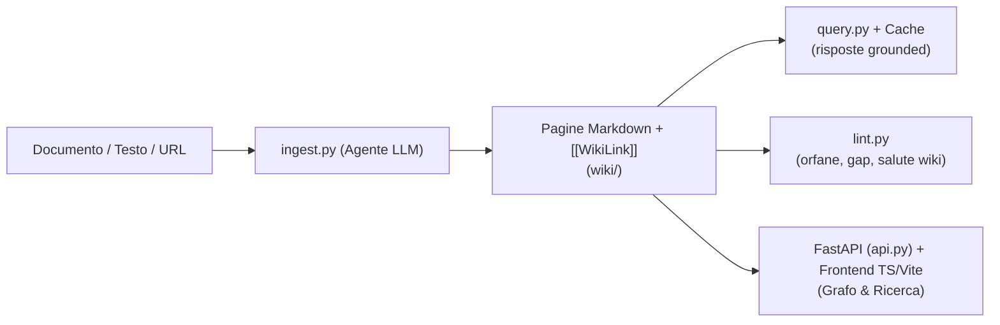

# llmwiki

> Base di conoscenza personale LLM in stile Karpathy: ingestion di documenti e URL in pagine Markdown con `[[WikiLink]]`, query grounded con cache, grafo interattivo e lint automatico.

## Concetti
[[TypeScript]] [[Python]] [[JavaScript]] [[LLM]]

## Panoramica
**llmwiki** (repo: https://github.com/pakkio/llmwiki, ultimo push 2026-04-30, metadati aggiornati 2026-11-24) trasforma documenti, testo incollato o URL in un wiki personale di pagine Markdown interconnesse tramite un loop agentico (DeepSeek V4-Flash). Le query rispondono **esclusivamente** da quanto ingerito nel wiki (nessuna allucinazione dai pesi di training), con caching delle risposte ripetute e controlli di integrità (`lint.py`: pagine orfane, gap, incoerenze).

Include CLI (`ingest`, `query`, `index`, `show`, `log`, `graph`), backend **FastAPI** (`api.py`) e frontend **React / TypeScript / Vite** (`frontend/`) con grafo force-directed interattivo.

## Flusso operativo



## Struttura (top-level)
```text
api.py          Backend FastAPI (health, readme, query, ingest, graph)
main.py         CLI principale
ingest.py       Pipeline di ingestion (file, testo, URL)
query.py        Agente di query grounded su indice wiki
lint.py         Verifica salute del wiki
llm.py, wiki.py Wrapper LLM e gestione pagine Markdown
frontend/       Web UI TypeScript/React (Vite)
wiki/           Pagine Markdown generate (es. Transformer, RAG, Babilonia...)
pyproject.toml  Python >= 3.12 (openai, fastapi, uvicorn, rich)
```

## Tech Stack
- **TypeScript / React** (`frontend/`), **Python 3.12+** (`FastAPI`, `uvicorn`, `openai`, `rich`, `uv`).
- Repository: https://github.com/pakkio/llmwiki (pubblico, verificato 2026-11-27)

## Progetti correlati
- [[llmwiki1]], [[skills]] (skill `/wiki`), [[mragent]], [[jev-rag]], [[fastobsidian]]

## Link
- Repository: https://github.com/pakkio/llmwiki
- Path locale: `/home/pakkio/w/llmwiki`
