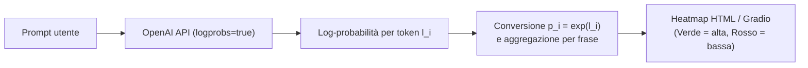

# logprob

> Sentence Confidence Analyzer: analisi visuale di autocertezza token-by-token e per frase sui modelli OpenAI tramite `logprobs` per rilevare potenziali allucinazioni.

## Concetti
[[LLM]] [[Python]] [[Web]]

## Panoramica
Analizza e visualizza con una scala cromatica (verde $\to$ giallo $\to$ rosso) la confidenza con cui modelli OpenAI (GPT-4.1, GPT-4o, 4o-mini, 4-turbo, 3.5-turbo) generano ogni token, parola e frase, facilitando l'individuazione rapida di passaggi incerti o possibili allucinazioni. Disponibile sia come app **Gradio** (`logprob_gradio.py`, `gradio2.py`) sia come pagina HTML standalone (`logprob.html`).

## Flusso di analisi

## Formulazione matematica
Dato il logaritmo naturale della probabilità $\ell_i = \ln p(t_i \mid t_{<i})$ restituito dall'API per il token $t_i$, la confidenza percentuale del singolo token è:

$$p_i = e^{\ell_i} \times 100\%$$

Su una frase $S = (t_1, \dots, t_n)$, la confidenza media geometrica e la perplessità sono:

$$C(S) = 100 \cdot \exp\!\left(\frac{1}{n}\sum_{i=1}^{n} \ell_i\right), \qquad \mathrm{PPL}(S) = \exp\!\left(-\frac{1}{n}\sum_{i=1}^{n} \ell_i\right)$$

## Tech Stack
- Python (Poetry, Gradio), HTML standalone.
- Repository: https://github.com/pakkio/logprob (pubblico, verificato 2026-11-27)
