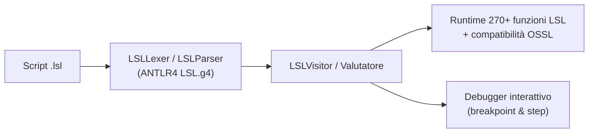

# lsl_simulator

> Parser ANTLR4 unificato e simulatore/debugger interattivo di script LSL in Python con oltre 270 funzioni LSL e compatibilità OSSL.

## Concetti
[[Python]] [[OpenSim]]

## Panoramica
Implementazione Python production-ready (repo: https://github.com/pakkio/lsl_simulator) per il parsing, la simulazione e il debug locale di script LSL senza avviare una regione OpenSim:
- **Parser ANTLR4 unificato (`LSL.g4`)**: singolo sistema di parsing per tutta la sintassi LSL.
- **Runtime esteso**: 270+ funzioni LSL (`lsl_api_expanded.py`) + compatibilità OSSL (`lsl_ossl_compatibility.py`), thread-safe.
- **Debugger interattivo**: esecuzione step-by-step con breakpoint (`lsl_debugger.py script.lsl`, `lsl.py script.lsl`).

## Pipeline di esecuzione

## Tech Stack
- Python (Poetry, ANTLR4, pytest), grammatica `LSL.g4`.
- Repository: https://github.com/pakkio/lsl_simulator (pubblico, verificato 2026-11-27)

## Collegamenti
[[oslsl]], [[ppd]], [[CraftSim]]
