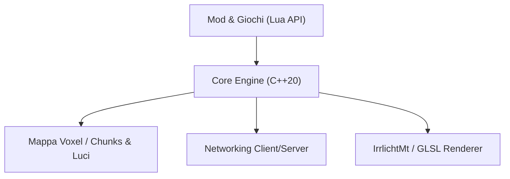

# luanti

> Fork personale di Luanti (ex Minetest): motore open-source C++/Lua per mondi voxel, con note di code review e idee di ottimizzazione su Irrlicht.

## Concetti
[[C++]] [[Virtual Worlds]]

## Panoramica
**luanti** (repo fork: https://github.com/pakkio/luanti) è il fork di `luanti-org/luanti` (ex Minetest), piattaforma voxel open-source con modding in Lua e rendering basato su IrrlichtMt / OpenGL. Il fork tracciato al 2026-11-21 include le recenti API Lua per matrici/rotazioni di upstream e note dedicate di analisi e ottimizzazione del layer grafico Irrlicht (`fc602a5`).

## Architettura



## Struttura (top-level)
```text
src/               motore C++ (client, server, scripting Lua, mappa)
irr/               fork interno IrrlichtMt
builtin/           API Lua di base e menu principale
CMakeLists.txt     build CMake + preset
Dockerfile         build containerizzato
```

## Progetti correlati
- [[CraftSim]] — simulatore mondi virtuali OpenSim
- [[CraftStorm]] — viewer WebGL e C++ per mondi virtuali
- [[Legacy e Fork]] — include anche il vecchio fork `wiki` (in-game wiki per Minetest)

## Link
- Repository: https://github.com/pakkio/luanti (fork, ultimo push 2026-11-21)
