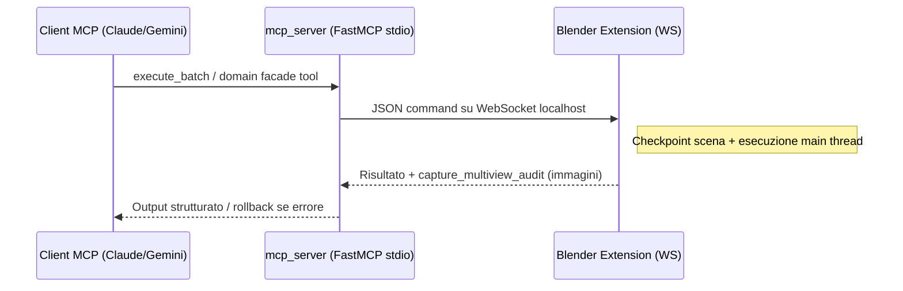

# mcp-blender

> Production-grade MCP bridge (v2.3.6) per Blender 4.2+ / 5.x: 146 tool nativi, 10 facade low-context (-90% token), batch transazionali con rollback, audit visivo multiview e CLI Go.

## Concetti
[[Blender]] [[MCP]] [[Python]] [[Go]]

## Panoramica
**mcp-blender** (`v2.3.6`, repo: https://github.com/pakkio/mcp-blender) collega client MCP (Claude Code, Claude Desktop, Antigravity, ecc.) a Blender 4.2+ / 5.x attraverso un bridge a due processi:
- **`extension/`**: Blender Native Extension (`blender_manifest.toml`) che esegue un server WebSocket locale e instrada i comandi in modo sicuro sul main thread di Blender con HUD viewport non-modale.
- **`mcp_server/`**: pacchetto Python installabile via pip (trasporto stdio tramite FastMCP) che comunica via WebSocket con l'estensione.
- **`tools/mcp-blender-pp-cli/`**: CLI dedicata in **Go** (per questo GitHub segnala Go tra i linguaggi principali).
- **`.claude/skills/`** (2026-10-25): skill di workflow 3D, inclusa la skill `sgabello` (workflow Meshy AI e modellazione manuale per mondi virtuali).

## Architettura



## Punti di forza (`v2.3.6`)
| Capacità | MCP Blender generici | `mcp-blender` (v2.3.6) |
| :--- | :--- | :--- |
| **Strumenti** | ~5–15 tool base / `exec` | **146 tool nativi / 10 facade di dominio unificate** |
| **Overhead di contesto** | Elevato per-tool | **Modalità aggregata (-90% token) + `blender_docs` on-demand** |
| **Architettura** | Addon zip legacy 2.8/3.x | **Blender 4.2+ & 5.x Native Extension** |
| **Sicurezza transazionale** | Nessuna | **`execute_batch` con rollback automatico** + `create/restore_scene_checkpoint` |
| **Job asincroni** | Freeze UI | `get_job_status`, `cancel_job`, `list_jobs` |
| **Audit visivo multimodale** | Cieco | `capture_multiview_audit` (4 angolazioni), `inspect_focus_shot`, `evaluate_scene_visually` (Gemini 2.5 Flash) |
| **Asset & AI 3D** | Nessuno | Poly Haven, Sketchfab, ambientCG, Meshy AI, Tripo3D, Trellis 3D |
| **Rigging, Hair, VFX** | Base | Humanoid metarig + IK/Spline IK, Hair Curves, Grease Pencil v3, Camera Tracking |
| **Geometry Nodes & PBR** | Base | Procedural graphs, VDB remesh, edge-wear, triplanar, auto-PBR |
| **Export Game Engine** | Grezzo | `export_unity_fbx` (fix rotazione $-90^\circ$ asse X), `generate_lods`, Draco GLTF/GLB, animation baking |

## Struttura (top-level)
```text
extension/       Blender Native Extension (WebSocket server + tool handler)
mcp_server/      Server MCP Python (FastMCP stdio)
tools/           mcp-blender-pp-cli (Go CLI)
.claude/skills/  Skill operative (es. sgabello)
demo/, scripts/, tasks/, tests_live/
```

## Tech Stack
- **Python** (extension & MCP server), **Go** (`tools/mcp-blender-pp-cli`), Makefile.
- Repository: https://github.com/pakkio/mcp-blender (pubblico, release `v2.3.6`, ultimo push 2026-10-25)

## Progetti correlati
- [[cck]]
- [[mcp-cck]]
- [[mcp-unity]]

## Link
- Repository: https://github.com/pakkio/mcp-blender
- Path locale: `/home/pakkio/w/mcp-blender`
