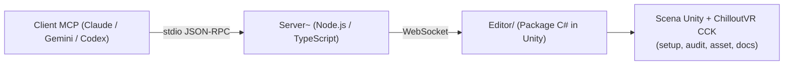

# mcp-cck

> Server MCP per Unity Editor e ChilloutVR CCK (v1.8.1): setup/audit CCK live, workflow recipes, posizionamento asset e documentazione interrogabile via `get_mcp_docs`.

## Concetti
[[MCP]] [[Unity]] [[C Sharp]] [[TypeScript]] [[JavaScript]]

## Panoramica
Evoluzione/variante specializzata di [[mcp-unity]] (repo: https://github.com/pakkio/mcp-cck, ultima release **`v1.8.1`** del 2026-11-26) che espone Unity Editor e le workflow **ChilloutVR CCK** ai client MCP.

### Novità recenti (v1.8.0 – v1.8.1)
- **`get_mcp_docs` (`v1.8.1`)**: strumento MCP per elencare, leggere e cercare la documentazione integrata direttamente dal contesto dell'agente.
- **Setup e audit CCK live (`v1.8.0`)**: verifica automatica della scena CCK, workflow recipes integrate e fix del posizionamento degli asset.
- **Installazione semplificata (`INSTALL.md`)**: supporto installazione via Git URL e release zip.

## Architettura

## Tech Stack
- C# (`Editor/`), TypeScript/JavaScript (`Server~/`), Dockerfile.
- Repository: https://github.com/pakkio/mcp-cck (pubblico, release `v1.8.1`, ultimo push 2026-11-26)

## Collegamenti
[[cck]], [[mcp-unity]], [[mcp-blender]]
