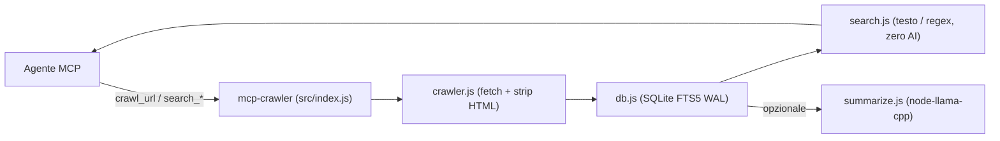

# mcp-crawler

> Server MCP in Node.js che crawla URL, indicizza il testo pulito in SQLite FTS5 (WAL) e cerca con testo o regex senza consumare token AI nel retrieval (con riassunto opzionale locale via `node-llama-cpp`).

## Concetti
[[MCP]] [[JavaScript]] [[Web]] [[Database]]

## Panoramica
Server MCP stdio (repo: https://github.com/pakkio/mcp-crawler) progettato nella skill `verbosity-control` ([[skills]]) come alternativa locale a WebFetch/WebSearch per tenere le pagine web fuori dal contesto della conversazione:
- **Tool MCP**: `crawl_url`, `search_text`, `search_regex`, `list_indexed_pages`, `crawler_stats`, `clear_index`.
- **Moduli (`src/`)**: `crawler.js` (fetch + HTML stripping), `db.js` (`data/crawler.db`, `better-sqlite3` WAL), `search.js` (query FTS5/regex), `summarize.js` (riassunto locale opzionale tramite `node-llama-cpp`), `index.js` (wiring MCP).

## Flusso

## Tech Stack
- JavaScript / Node.js, `better-sqlite3` (WAL), `@modelcontextprotocol/sdk`, `node-llama-cpp`.
- Repository: https://github.com/pakkio/mcp-crawler (pubblico, verificato 2026-11-27)

## Collegamenti
[[mcp-dotenv]], [[mcp-local_llm]], [[skills]]
