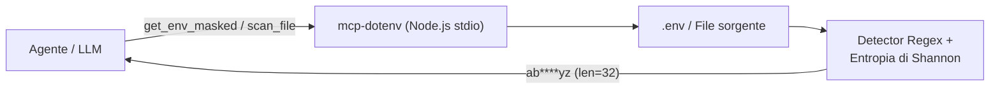

# mcp-dotenv

> Server MCP in Node.js per leggere/gestire file `.env` e rilevare segreti nel codice **senza mai esporre i valori in chiaro** al modello (output mascherato + entropia di Shannon).

## Concetti
[[MCP]] [[JavaScript]] [[CLI]]

## Panoramica
Server MCP stdio (repo: https://github.com/pakkio/mcp-dotenv) che isola i segreti dal contesto dell'LLM restituendo solo forme mascherate (`ab****yz (len=32)`). Nella skill `verbosity-control` ([[skills]]) funge da server MCP locale per la gestione sicura dei segreti.

- **Tool MCP**: `list_env_keys`, `check_env_exists`, `get_env_masked`, `describe_env_value`, `set_env_value`, `delete_env_key`, `scan_file`, `scan_directory`, `redact_file`.
- **Rilevamento segreti**: regex dedicate (AWS, GitHub, GitLab, Slack, Google, Stripe, OpenAI/Anthropic, JWT, blocchi chiave privata, connection string DB, header Bearer, SSH) + fallback basato su **entropia di Shannon**.

## Flusso di isolamento dei segreti

## Fallback a entropia di Shannon
Per individuare token ad alta casualità non coperti dalle regex note, viene calcolata l'entropia di Shannon per carattere su una stringa di lunghezza $N$ con frequenze $p_i$:

$$H(X) = -\sum_{i=1}^{k} p_i \log_2 p_i \qquad \text{(bit/carattere)}$$

Stringhe lunghe con $H(X)$ elevata (tipicamente $> 4{,}5\text{ bit/char}$ in base64/hex) vengono segnalate come potenziali segreti.

## Tech Stack
- JavaScript / Node.js (`src/`, `package.json`).
- Repository: https://github.com/pakkio/mcp-dotenv (pubblico, verificato 2026-11-27)

## Collegamenti
[[mcp-crawler]], [[mcp-local_llm]], [[skills]]
