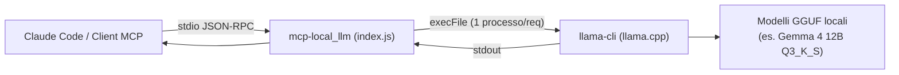

# mcp-local_llm

> Server MCP in Node.js per delegare domande standalone e ripetitive a modelli locali Gemma 4 tramite invocazione diretta di `llama-cli` (zero server HTTP persistente, zero token pagati).

## Concetti
[[MCP]] [[LLM]] [[JavaScript]]

## Panoramica
Server MCP JavaScript (repo: https://github.com/pakkio/mcp-local_llm, ultimo push 2026-08-02) che consente a Claude Code e altri client MCP di scaricare query banali o standalone su modelli locali **Gemma 4** (incluso **Gemma 4 12B Q3_K_S** come terzo modello selezionabile).

### Architettura diretta (aggiornamento 2026-08-01/02)
Ogni chiamata `ask_local_llm` avvia direttamente `llama-cli` tramite `execFile` di Node.js (un processo per richiesta) e legge `stdout`, **senza `llama-server` persistente né hop HTTP** (eliminati i problemi di `RUNPATH` e sessioni GPU orfane; supporta prompt multilinea). Tool esposti: `ask_local_llm`, `local_llm_health`, `local_llm_stats`, `switch_local_llm_model`, `report_review`.

## Collegamenti
[[local_llm]], [[mcp-crawler]], [[mcp-dotenv]], [[skills]]

## Link
- Repository: https://github.com/pakkio/mcp-local_llm (pubblico, verificato 2026-11-27)
