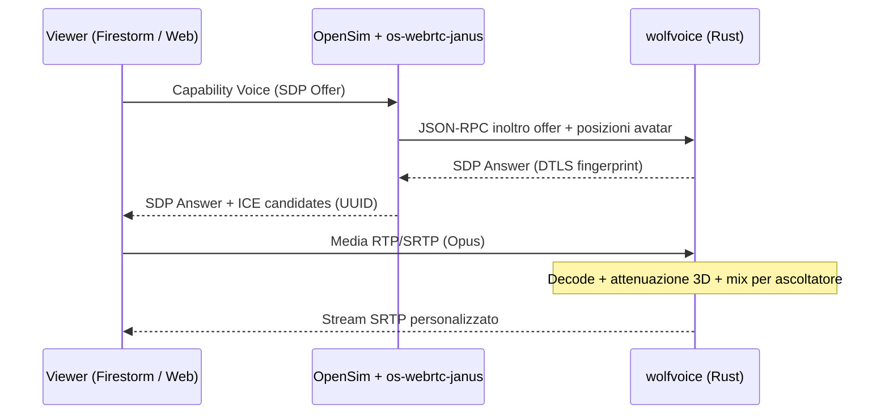

# mcp-wolfvoice

> Servizio voce WebRTC spaziale in Rust per OpenSimulator (`wolfvoice`): compatibile contemporaneamente con Firestorm 7.1.10+ e viewer web senza gateway Janus.

## Concetti
[[Rust]] [[OpenSim]] [[Virtual Worlds]] [[MCP]]

## Panoramica
**wolfvoice** (repo: https://github.com/pakkio/mcp-wolfvoice, ultimo push 2026-10-11) è un backend voce in **Rust** per l'addon `os-webrtc-janus` di OpenSimulator. Consente a viewer nativi (Firestorm 7.1.10+, [[CraftStorm]]) e viewer browser di raggiungersi tramite le capability della regione e sentirsi reciprocamente con audio posizionale 3D.

wolfvoice risponde direttamente all'SDP, termina DTLS/SRTP/SCTP e produce un mix **separato per ciascun ascoltatore**, eliminando la necessità di un gateway Janus esterno.

### Aggiornamenti recenti (ottobre 2026)
- Session ID come UUID nudi per la corretta consegna dei candidati ICE da parte dei viewer.
- Rilevamento e logging delle transizioni di attività microfono dai livelli RTP decodificati, con livello di log controllabile live.

## Flusso di segnalazione e mixing

## Modello audio posizionale
Per ciascuna coppia parlante–ascoltatore a distanza euclidea $d = \|\mathbf{p}_s - \mathbf{p}_l\|_2$, il guadagno di attenuazione spaziale decresce oltre la distanza di riferimento $d_{\min}$:

$$g(d) = \begin{cases} 1 & d \le d_{\min} \\ \left(1 + \dfrac{d - d_{\min}}{d_{\text{ref}}}\right)^{-\alpha} & d_{\min} < d < d_{\max} \\ 0 & d \ge d_{\max} \end{cases}$$

## Tech Stack
- **Rust** (`Cargo.toml`, `src/`), JavaScript (`client/`), Shell (`setup.sh`), `docs/`, `examples/`.
- Richiede host Linux con IP pubblico, DNS e TLS (il fingerprint DTLS è incluso nell'SDP).
- Repository: https://github.com/pakkio/mcp-wolfvoice (pubblico, verificato 2026-11-27)

## Collegamenti
- Lato server in [[CraftSim]]: [[Voice (WebRTC, Janus & SynthVoice)]]
- Lato client in [[CraftStorm]]: [[CraftStorm Web - Avatars, Animesh, Movement & Audio]]
