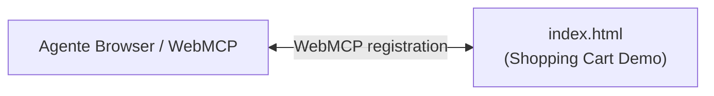

# mcpweb

> Prototipo HTML single-page per **WebMCP**: registrazione di tool lato browser su un carrello e-commerce dimostrativo.

## Concetti
[[MCP]] [[Web]]

## Panoramica
Repo statico minimale (`index.html`, `README.md`, repo: https://github.com/pakkio/mcpweb, ultimo push 2026-02-27) che sperimenta la registrazione **WebMCP** direttamente nel browser attorno a un'interfaccia carrello (*shopping cart*), permettendo a un agente web di invocare azioni esposte dalla pagina HTML.

## Tech Stack
- HTML / JavaScript vanilla.
- Repository: https://github.com/pakkio/mcpweb (pubblico, verificato 2026-11-27)

## Collegamenti
[[MCP]], [[mcp-blender]], [[mcp-cck]], [[fastobsidian]]
