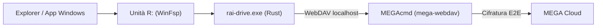

# mega (rai-drive)

> Clone leggero in Rust stile RaiDrive per montare un account MEGA come lettera di unità Windows (`R:`) in lettura e scrittura via WinFsp + MEGAcmd.

## Concetti
[[Rust]] [[CLI]]

## Panoramica
**mega** (progetto interno `rai-drive`, repo privato: https://github.com/pakkio/mega) monta uno spazio cloud **MEGA** come disco locale Windows tramite **WinFsp**. Poiché MEGA utilizza cifratura client-side proprietaria, il protocollo MEGA è delegato a **MEGAcmd** (`mega-webdav`), mentre il binario Rust espone il filesystem WinFsp dialogando via WebDAV su localhost.

Include fix specifici per le peculiarità di MEGAcmd (es. entità non standard `&add;` per `+` nei listing WebDAV) e lettura credenziali da `MEGA_USER` in `.env`.

## Architettura



## Uso
```powershell
.\rai-drive.ps1
# oppure tramite justfile
just run
```

## Struttura (top-level)
```text
Cargo.toml, Cargo.lock   manifest Rust
build.rs                 integrazione build WinFsp
src/                     filesystem WinFsp + client WebDAV
rai-drive.ps1            script di avvio/mount da PowerShell utente
justfile                 ricette rapide (es. just run)
README.md
```

## Progetti correlati
- [[MegaFuse]] — alternativa/esperimento precedente in C++ per il mount di MEGA su FUSE

## Link
- Repository: https://github.com/pakkio/mega (privato, ultimo push 2026-10-22)
