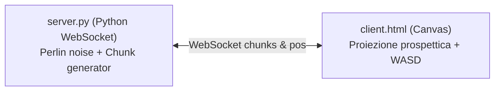

# mondovirtuale

> Mondo virtuale minimale con generazione procedurale del terreno (Perlin noise), streaming a chunk via WebSocket e proiezione prospettica pseudo-3D su HTML Canvas.

## Concetti
[[Virtual Worlds]] [[Python]] [[Web]]

## Panoramica
Prototipo compatto (`server.py` + `client.html`, repo: https://github.com/pakkio/mondovirtuale): il server Python genera chunk procedurali di terreno con Perlin noise (erba/pietra in funzione dell'elevazione) e li sincronizza via WebSocket verso un client browser con rendering pseudo-3D prospettico, movimento WASD e mouse-look.

La proiezione prospettica di un punto 3D $(x, y, z)$ in coordinate camera su uno schermo con lunghezza focale $f$:

$$x_{\text{screen}} = f\,\frac{x}{z}, \qquad y_{\text{screen}} = f\,\frac{y}{z} \qquad (z > 0)$$

## Tech Stack
- Python (`server.py`), HTML/JS Canvas (`client.html`).
- Repository: https://github.com/pakkio/mondovirtuale (pubblico, verificato 2026-11-27)

## Collegamenti
[[CraftStorm]], [[opensim-cpp]], [[luanti]]
