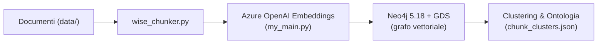

# ne4j

> Esperimenti di chunking semantico, embedding Azure OpenAI e clustering di documenti su grafo vettoriale **Neo4j 5.18** con Graph Data Science (GDS).

## Concetti
[[Python]] [[Database]] [[RAG]] [[LLM]]

## Panoramica
Pipeline sperimentale (repo privato: https://github.com/pakkio/ne4j, ultimo push 2026-10-18) per suddividere documenti (`wise_chunker.py`), calcolare embedding con Azure OpenAI e clusterizzarli dentro un database a grafo vettoriale Neo4j 5.18 (`docker-compose.yaml` con plugin `graph-data-science`). Include wrapper LLM (`commons/` per ChatGPT e Gemini Flash), esperimenti di ontologia/gerarchia (`hierarchy/`, `experiments/`) e risultati JSON (`chunk_clusters.json`, `analyzed_clusters.json`, `similar_chunks.json`).

## Pipeline su Neo4j

## Tech Stack
- Python, Neo4j 5.18 + Graph Data Science (Docker), Azure OpenAI, ChatGPT / Gemini Flash.
- Repository: https://github.com/pakkio/ne4j (privato, verificato 2026-11-27)

## Collegamenti
[[llmrag]], [[mragent]], [[jev-rag]]
