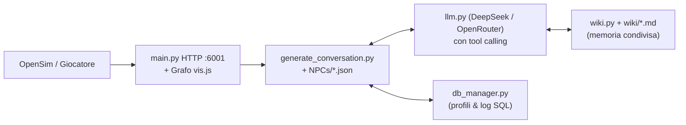

# nexus2

> Evoluzione di Nexus: motore GDR testuale AI ambientato in Eldoria per NPC Second Life / OpenSim con wiki Markdown persistente letta/scritta via tool calling e pannello HTTP su porta 6001.

## Concetti
[[AI Agents]] [[LLM]] [[Python]] [[Database]] [[OpenSim]]

## Panoramica
Successore di [[nexus]] (repo: https://github.com/pakkio/nexus2, ultimo push 2026-10-18):
- **Wiki persistente (`wiki.py`, `wiki/`)**: file Markdown letti e aggiornati direttamente dagli NPC tramite LLM tool calling, con grafo wiki visualizzato via `vis.js`.
- **Agenti NPC (`NPCs/*.json`)**: personalità guidate da LLM (DeepSeek V4-Flash / OpenRouter) con profiling psicologico del giocatore persistito tra sessioni (`db_manager.py`, `database_schema.sql`).
- **Pannello di controllo HTTP** su porta `6001` (`main.py`, `ThreadingHTTPServer` stdlib).
- **Tool di manutenzione e benchmark**: `backfill_conversation_pages.py`, `migrate_titles.py`, `sort_links.py`, `measure_wiki_tool_latency.py`, `simulate_jorin_prompt.py`. Dettagli in `TECHNICAL.md`.

## Architettura

## Tech Stack
- Python (stdlib `ThreadingHTTPServer`), SQL DB, vis.js, Markdown wiki.
- Repository: https://github.com/pakkio/nexus2 (pubblico, verificato 2026-11-27)

## Collegamenti
[[nexus]], [[ppd]], [[nexus-narrative-weaver]], [[llmwiki]]
