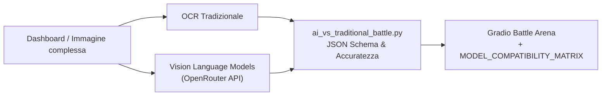

# ocr

> Advanced OCR Benchmark Suite (Battle Arena): confronto sistematico tra OCR tradizionale e Vision Language Models (VLM via OpenRouter) per estrazione JSON strutturata da immagini e dashboard complesse.

## Concetti
[[OCR]] [[Python]] [[LLM]]

## Panoramica
Suite di benchmark e app **Gradio** (repo: https://github.com/pakkio/ocr, pubblico, verificato 2026-11-27 — la precedente nota locale segnalava erroneamente 0 file) che mette a confronto OCR classici e modelli Vision Language (VLM) tramite OpenRouter su immagini complesse, valutando la robustezza del parsing JSON strutturato (`ai_vs_traditional_battle.py`, `advanced_ocr_app.py`, `ocr_tester.py`, `MODEL_COMPATIBILITY_MATRIX.md`).

## Pipeline di confronto

## Struttura (top-level)
`advanced_ocr_app.py`, `ai_vs_traditional_battle.py`, `ocr_tester.py`, `gradio_app.py`, `comprehensive_test_suite.py`, `MODEL_COMPATIBILITY_MATRIX.md`, `cache/`, `data/`, `poetry.lock`.

## Tech Stack
- Python 3.9+ (Poetry), Gradio, OpenRouter VLM API.
- Repository: https://github.com/pakkio/ocr (pubblico, verificato 2026-11-27)

## Progetti correlati
- [[ocrlocal]], [[comics-panel]], [[marker1]], [[nispa-ocr]]
