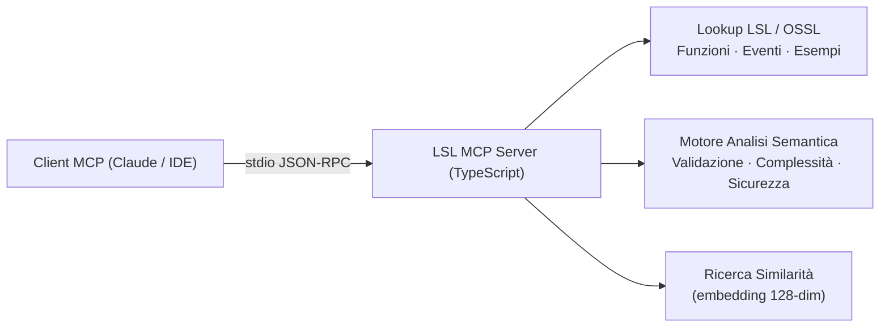

# oslsl

> Server MCP in TypeScript per LSL (Linden Scripting Language) e OSSL (OpenSimulator) con motore di analisi semantica, sicurezza e similarità vettoriale a 128 dimensioni.

## Concetti
[[MCP]] [[TypeScript]] [[OpenSim]]

## Panoramica
Server MCP specializzato (repo: https://github.com/pakkio/oslsl) per lo sviluppo su Second Life e OpenSimulator:
- **Documentazione completa**: lookup funzioni LSL, eventi LSL, estensioni OSSL, ricerca esempi e best practice.
- **Analisi semantica enterprise**: validazione con confidence score, metriche (memoria e complessità ciclomatica), scansione sicurezza/permessi OSSL, riconoscimento di pattern, estrazione codice pulito dai wiki e similarità tra funzioni tramite embedding a $128$ dimensioni.

## Architettura

## Tech Stack
- TypeScript / Node.js (`npm run build`, test Jest), script wrapper WSL/Windows (`start-server.bat`, `run-server.sh`).
- Repository: https://github.com/pakkio/oslsl (pubblico, verificato 2026-11-27)

## Collegamenti
[[lsl_simulator]], [[CraftSim]] (estensioni OSSL)
