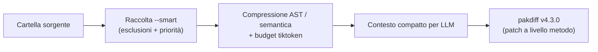

# pak

> CLI Python per impacchettare un intero folder in un contesto compresso ottimizzato per LLM (`--smart`, compressione AST/semantica, token budget) e applicare modifiche via `pakdiff` (`v4.3.0`).

## Concetti
[[LLM]] [[CLI]] [[Python]]

## Panoramica
Elimina il copia-incolla manuale verso Claude/ChatGPT (repo: https://github.com/pakkio/pak, ultimo push 2025-08-07): raccoglie selettivamente i file (`--smart`, esclusioni `.git`/`venv`/`node_modules`), misura il budget di token con `tiktoken`, comprime il codice a livello AST/semantico e gestisce patch strutturate a livello di metodo (`PAKDIFF.md`, `pakdiff v4.3.0` multi-linguaggio).

## Pipeline

File principali: `pak.py`, `pak_analyzer.py`, `pak_archive_manager.py`, `ast_helper.py`, `llm_wrapper.py`, `hook-tiktoken.py`, `PAKDIFF.md`.

## Tech Stack
- Python (tiktoken, AST), Shell (`install.sh`, `build_and_deploy.sh`).
- Repository: https://github.com/pakkio/pak (pubblico, verificato 2026-11-27)

## Collegamenti
[[pakagent]], [[rlm]]
