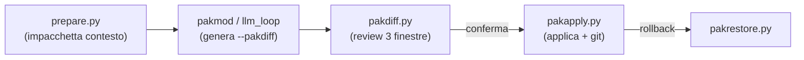

# pakagent

> Workflow sicuro a 5 programmi per lo sviluppo assistito da LLM basato su `pak` e `pakdiff`, con sanitizzazione input, revisione in terminale a 3 pannelli e integrazione Git.

## Concetti
[[AI Agents]] [[LLM]] [[CLI]] [[Python]]

## Panoramica
Automatizza l'intero ciclo di modifica del codice tramite LLM (repo: https://github.com/pakkio/pakagent) separando preparazione, generazione, revisione visiva e applicazione sicura:
- `prepare.py` – impacchetta i file rilevanti in `/tmp/archive.txt` (logging compatto)
- `pakmod.py` / `llm_loop.py` / `local_loop.py` – invia all'LLM e riceve modifiche (`--pakdiff`)
- `pakdiff.py` – revisione interattiva in terminale a 3 finestre
- `pakapply.py` – applica le patch solo dopo validazione e conferma
- `pakrestore.py` / `pakview.py` – ripristino sicuro e ispezione

## Ciclo di lavoro

## Tech Stack
- Python (Poetry, PyInstaller `.spec`, pre-commit, test suite).
- Repository: https://github.com/pakkio/pakagent (pubblico, verificato 2026-11-27)

## Collegamenti
[[pak]], [[agent]]
