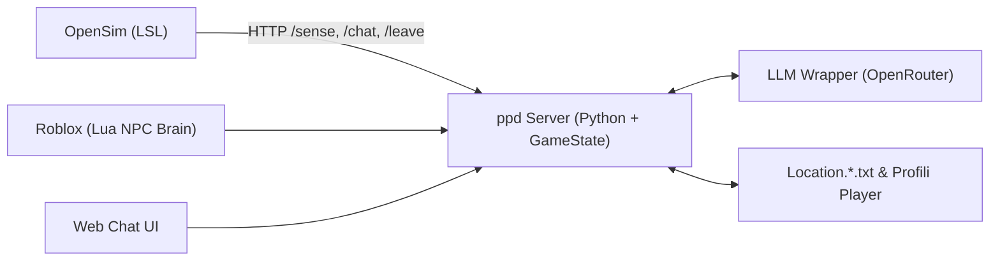

# ppd

> NPC AI Brain per OpenSim e **Roblox** (repo privato): personaggi interattivi a tema *Piccolo Principe* guidati dal motore Nexus/Eldoria, con web chat UI, `GameState` thread-safe e script Lua/LSL.

## Concetti
[[OpenSim]] [[LLM]] [[AI Agents]] [[Python]] [[Virtual Worlds]]

## Panoramica
Repository privato (https://github.com/pakkio/ppd, ultimo push 2026-06-13) che estende il motore [[nexus]] con contenuti narrativi a tema *Piccolo Principe* (asteroide B612, pianeti algoritmi, contabile, emozioni, geografo, influencer, lampionaio, programmatore, ricordi, nodo centrale), `ARCHITETTURA_NARRATIVA_COMPLETA.md`, guide BVH e supporto **multi-piattaforma**:
- **OpenSim**: script LSL `NPC_AI_Brain_Complete.lsl` via `HttpRequestModule`.
- **Roblox** (aggiornamento giugno 2026): script Lua NPC brain, web chat UI, endpoint dedicati alle conversazioni NPC, `GameState` dataclass thread-safe e sanificazione input.

## Tech Stack
- Python, LSL, Lua (Roblox), OpenSim.ini (`HttpRequestModule`).
- Repository: https://github.com/pakkio/ppd (privato, verificato 2026-11-27)

## Collegamenti
[[nexus]], [[nexus2]], [[nexus-narrative-weaver]], [[lsl_simulator]]
