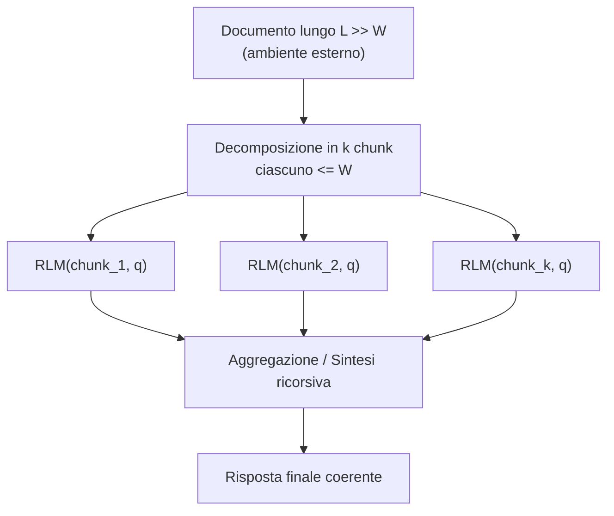

# rlm

> Implementazione dei Recursive Language Models (RLM, Zhang/Kraska/Khattab, arXiv:2512.24601) con Gemini Flash 2.5 e OpenRouter per elaborare contesti di 2+ ordini di grandezza oltre la finestra del modello.

## Concetti
[[CLI]] [[LLM]] [[Python]]

## Architettura ricorsiva RLM



## Modello di complessità
Un documento di lunghezza $L \gg W$ (finestra di contesto del modello base) viene partizionato con fattore di ramificazione $b$ in una gerarchia di profondità $h = \lceil \log_b (L / W) \rceil$: il costo cresce linearmente con la lunghezza del testo invece che quadraticamente con l'attenzione piena:

$$C_{\text{full}}(L) = \mathcal{O}(L^2) \quad \longrightarrow \quad C_{\text{RLM}}(L) = \mathcal{O}\!\left(\frac{L}{W} \cdot W^2\right) = \mathcal{O}(L \cdot W)$$

## Panoramica
# Recursive Language Model (RLM) Demo

Implementation of Recursive Language Models using **Gemini Flash 2.5**, based on the paper ["Recursive Language Models"](https://arxiv.org/abs/2512.24601) by Zhang, Kraska, and Khattab.

## What is RLM?

Recursive Language Models (RLM) treat long prompts as an external environment that the LLM can programmatically examine, decompose, and recursively call itself over. This enables:

- Handling inputs **2+ orders of magnitude** beyond model context windows
- Better quality than base LLMs on long-context tasks
- Comparable or cheaper cost per query

## Key Innovation

Instead of cramming everything into a single prompt, RLM:

1. **Decomposes** long contexts into manageable chunks
2. **Recursively processes** each chunk with the user's query
3. **Aggregates** results into a coherent final answer

This mirrors how humans process large documents - we don't read everything at once, we examine relevant sections and synthesize information.

## Setup

### 1. Install Dependencies

Using Poetry (recommended):

```bash
poetry install
```

Or using pip:

```bash
pip install google-generativeai python-dotenv
```

### 2. Get API Keys

#### Option A: Google AI (Direct)

1. Go to [Google AI Studio](https://makersuite.google.com/app/apikey)
2. Create an API key
3. Copy `.env.example` to `.env`:
   ```bash
   cp .env.example .env
   ```
4. Add your API key to `.env`:
   ```
   GOOGLE_API_KEY=your_actual_api_key_here
   ```

#### Option B: OpenRouter (Recommended - supports multiple models)

1. Go to [OpenRouter](https://openrouter.ai/keys)
2. Create an API key
3. Copy `.env.example` to `.env`:
   ```bash
   cp .env.example .env
   ```
4. Add your API key to `.env`:
   ```
   OPENROUTER_API_KEY=your_actual_api_key_here
   ```

## Usage

### Using OpenRouter (Recommended)

#### Basic Document Analysis with OpenRouter

```bash
poetry run python demo_openrouter.py
```

Uses Gemini Flash 2.5 Lite via OpenRouter to analyze a long AI overview document.

#### Interactive Mode with OpenRouter

```bash
poetry run python demo_interactive_openrouter.py
```

Chat with your documents using OpenRouter:
- Load any text document
- Ask multiple questions interactively
- Uses Gemini Flash 2.5 Lite for cost-effective processing

### Using Google AI Direct

#### Basic Document Analysis

```bash
poetry run python demo_basic.py
```

This demo shows how RLM handles a long AI overview document, answering questions by:
- Breaking the document into semantic chunks
- Processing each chunk with the query
- Synthesizing results into coherent answers

#### Code Repository Analysis

```bash
poetry run python demo_code_analysis.py
```

Analyzes a Flask API codebase, answering questions like:
- "What authentication method is used?"
- "What security vulnerabilities exist?"
- "List all API endpoints"

#### Interactive Mode

```bash
poetry run python demo_interactive.py
```

Features:
- Load any text document
- Ask multiple questions interactively
- See how RLM decomposes and processes your content

## How It Works

### Architecture

```
User Query + Long Context
         |
         v
   [Estimate Size]
         |
    Too Large?
    /         \
  NO          YES
   |           |
   v           v
Direct      Decompose
Call        into Chunks
   |           |
   |           v
   |    [Recursive Processing]
   |     - Process each chunk
   |     - Collect results
   |           |
   |           v
   |    [Aggregation]
   |     - Synthesis or
   |       Concatenation
   |           |
    \         /
     \       /
      v     v
    Final Answer
```

### Code Structure

- `rlm.py` - Core RLM implementation (Google AI)
- `rlm_openrouter.py` - RLM with OpenRouter support
  - `RecursiveLanguageModel` class with multi-backend support
  - `OpenRouterBackend` - OpenRouter API integration
  - `GoogleAIBackend` - Google AI integration
  - Chunking strategies
  - Recursive processing
  - Result aggregation

**Demos:**
- `demo_openrouter.py` - OpenRouter with

## Tech Stack
- Linguaggi: Python (13)
- File totali (scan): 30
- Estensioni principali: .py=13, .md=9, .txt=2, (noext)=2, .toml=1, .lock=1, .example=1, .json=1

## Struttura (top-level)
```
CHUNK_SIZE_GUIDE.md
CONFIGURATION.md
DEBUG_GUIDE.md
LEGGIMI_PRIMA.md
PERFORMANCE_UPDATE.md
QUICK_FIX.md
README.md
TUTTO_PRONTO.md
VERBOSE_LOGGING.md
__pycache__
alice_sample.txt
demo_basic.py
demo_code_analysis.py
demo_interactive.py
demo_interactive_openrouter.py
demo_openrouter.py
demo_verbose.py
poetry.lock
pyproject.toml
rlm.py
rlm_openrouter.py
test_openrouter.py
test_war_and_peace.py
test_with_book.py
timed_test.py
verify_defaults.py
war_and_peace_sample.txt
```

## Documentazione presente nel repo
- `CHUNK_SIZE_GUIDE.md`
- `CONFIGURATION.md`
- `DEBUG_GUIDE.md`
- `LEGGIMI_PRIMA.md`
- `PERFORMANCE_UPDATE.md`
- `QUICK_FIX.md`
- `README.md`
- `TUTTO_PRONTO.md`
- `VERBOSE_LOGGING.md`

## Manifest
### pyproject.toml
```
[tool.poetry]
name = "rlm-demo"
version = "0.1.0"
description = "Recursive Language Models implementation using Gemini Flash 2.5"
authors = ["Your Name <you@example.com>"]
readme = "README.md"
license = "MIT"
keywords = ["rlm", "recursive-language-models", "gemini", "llm", "ai"]

[tool.poetry.dependencies]
python = "^3.9"
google-generativeai = "^0.8.0"
python-dotenv = "^1.0.0"
requests = "^2.31.0"

[tool.poetry.group.dev.dependencies]
pytest = "^8.0.0"
black = "^24.0.0"
ruff = "^0.1.0"

[build-system]
requires = ["poetry-core"]
build-backend = "poetry.core.masonry.api"

[tool.black]
line-length = 100
target-version = ['py39']

[tool.ruff]
line-length = 100
target-version = "py39"
```

## Progetti correlati
- [[agent]]
- [[assegna]]
- [[chatgroup]]
- [[gemmafunction]]
- [[llmwiki]]
- [[llmwiki1]]
- [[local_llm]]
- [[mragent]]
- [[search]]
- [[spirale]]
- [[subs]]
- [[tbi]]

## Link
- Path locale: `/home/pakkio/w/rlm`
