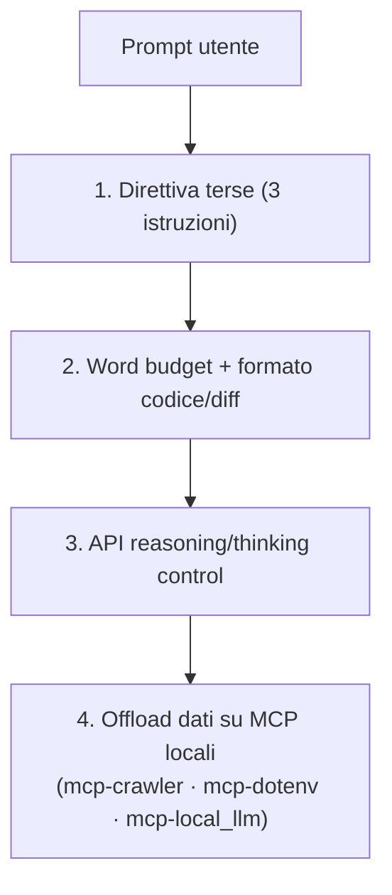

# skills

> Raccolta di skill per agenti Claude Code / Freebuff: `verbosity-control` (`/terse`, fino a $-95\%$ di token output) e `llm-wiki` (`/wiki`), con benchmark A/B riproducibili.

## Concetti
[[AI Agents]] [[LLM]] [[Python]] [[CLI]]

## Panoramica
Repository di skill operative e benchmark (repo: https://github.com/pakkio/skills, ultimo push 2026-08-02):
- **`verbosity-control` (`/terse`)**: blocca la prolissità dei modelli di ragionamento usando **output contract** espliciti ordinati per impatto: direttiva terse a 3 istruzioni, budget rigido di parole, vincoli di formato (solo codice/diff), controllo thinking via API, JSON-only, routing dei dati voluminosi su server MCP locali ([[mcp-crawler]], [[mcp-dotenv]], [[mcp-local_llm]]).
  - Nota tecnica OpenRouter: per DeepSeek `thinking: {type: disabled}` viene ignorato; occorre `reasoning: {effort: "none", enabled: false}`.
- **`llm-wiki` (`/wiki`)**: skill per mantenere una wiki Markdown persistente costruita dall'LLM (`raw/ -> pages/ -> schema`) al posto di RAG effimero. Vedi [[llmwiki]].
- **`benchmarks/`**: suite A/B riproducibile (`ab_terse_test.py`, `ab_sonnet5.py`).

## Risultati benchmark A/B (OpenRouter, 5 prove/braccio)

| Modello | Token output (baseline $\to$ `/terse`) | Riduzione | Costo |
|---|---:|---:|---:|
| `deepseek-v4-flash-0731` | $1\,846 \to 88$ | $-95{,}2\%$ | $-93\%$ |
| `claude-sonnet-5` | $1\,142 \to 215$ | $-81{,}2\%$ | qualità intatta |

$$\Delta_{\text{tok}} = \frac{T_{\text{terse}} - T_{\text{base}}}{T_{\text{base}}} \times 100\%$$

## Gerarchia dei controlli (`/terse`)

## Tech Stack
- Markdown (skill definitions) + Python (`benchmarks/`).
- Repository: https://github.com/pakkio/skills (pubblico, verificato 2026-11-27)

## Collegamenti
[[llmwiki]], [[mcp-crawler]], [[mcp-dotenv]], [[mcp-local_llm]]
