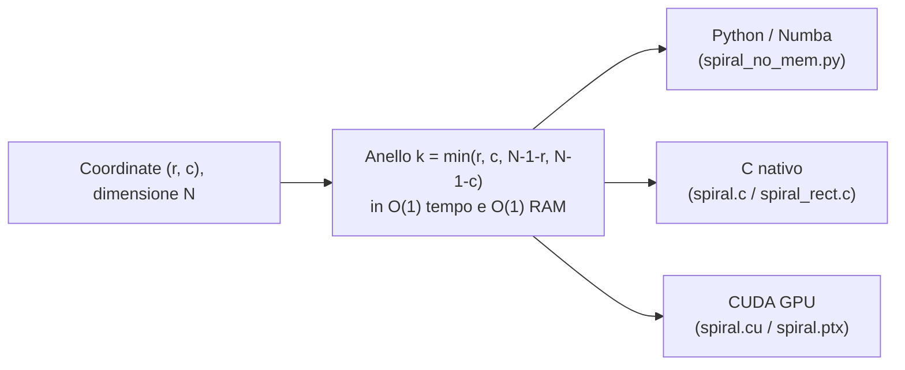

# spirale

> Calcolo in tempo $\mathcal{O}(1)$ e memoria $\mathcal{O}(1)$ di qualsiasi cella di matrici a spirale gigantesche (quadrate e rettangolari) senza allocarle in RAM, implementato in Python, Numba, C e CUDA con articolo LaTeX bilingue.

## Concetti
[[C++]] [[CLI]] [[Python]]

## Panoramica
Progetto locale (`/home/pakkio/w/spirale`, non pubblicato su GitHub `pakkio`) che confronta implementazioni Python, Numba, C (`spiral.c`, `spiral_rect.c`) e CUDA (`spiral.cu`, `spiral.ptx`) per calcolare direttamente il valore di ogni coordinata $(r, c)$ di una matrice a spirale $N \times N$ (o rettangolare $M \times N$) senza mai memorizzare la matrice. Corredato da articolo bilingue (`article.tex`, `article.it.tex`).

## Formula in forma chiusa $\mathcal{O}(1)$
Per una matrice quadrata $N \times N$ indicizzata $0 \le r, c < N$, l'anello (*layer*) di appartenenza è:

$$k = \min(r,\, c,\, N - 1 - r,\, N - 1 - c)$$

Il numero di celle negli anelli esterni precedenti e il lato $s = N - 2k$ dell'anello corrente forniscono il valore esatto in tempo costante $\mathcal{O}(1)$:

$$V_0(k) = 4k(N - k), \qquad V(r, c) = V_0(k) + \begin{cases} c - k & r = k \\ (s - 1) + (r - k) & c = N - 1 - k \\ 2(s - 1) + (N - 1 - k - c) & r = N - 1 - k \\ 3(s - 1) + (N - 1 - k - r) & c = k \end{cases}$$

## Confronto implementazioni

## Tech Stack
- Python (`spiral.py`, `spiral_no_mem.py`, `spiral_bench.py`, `test_rect.py`), C, CUDA, LaTeX (`article.tex`, `article.it.tex`).

## Progetti correlati
- [[FMM]], [[ChessChallenge]], [[assegna]]

## Link
- Path locale: `/home/pakkio/w/spirale` (progetto locale)
