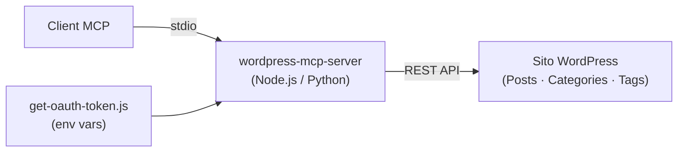

# wordpress

> Server MCP (doppia implementazione Node.js e Python) per pubblicare e gestire articoli, categorie e tag su un sito WordPress tramite OAuth.

## Concetti
[[MCP]] [[JavaScript]] [[Python]] [[Web]]

## Panoramica
Server MCP stdio (repo: https://github.com/pakkio/wordpress, ultimo push 2026-10-18) per la gestione di WordPress / WordPress.com direttamente da un client AI:
- **Implementazioni**: Node.js (`wordpress-mcp-server.js`, `mcp-server/`) e Python (`wordpress_mcp_server.py`), più `get-oauth-token.js` per generare il token OAuth.
- **Tool MCP**: `get_posts`, `create_post`, `update_post`, `get_categories`, `create_category`, `get_tags`, `create_tag`.

## Tech Stack
- JavaScript (Node.js), Python, WordPress REST API + OAuth.
- Repository: https://github.com/pakkio/wordpress (pubblico, verificato 2026-11-27)

## Collegamenti
[[MCP]]
