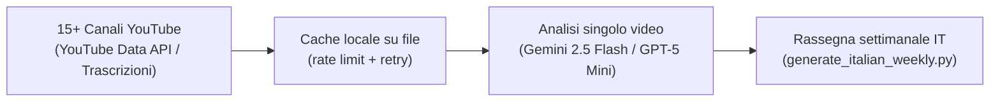

# youtube-news

> Sistema di rassegna stampa settimanale AI/tech in italiano a partire da 15+ canali YouTube internazionali e italiani, con caching locale e sintesi multi-LLM.

## Concetti
[[LLM]] [[Python]]

## Panoramica
Monitora oltre 15 canali YouTube AI/tech (inglesi e italiani), estrae trascrizioni e metadati, analizza i singoli video con caching su file per evitare chiamate duplicate e produce una rassegna stampa settimanale in stile giornale in italiano tramite modelli avanzati (Gemini 2.5 Flash, GPT-5 Mini via OpenRouter). Entry point principale: `video_processor_enhanced.py` (insieme a `generate_italian_weekly.py`, `generate_proper_weekly_summary.py`, `llm_wrapper.py`).

## Tech Stack
- Python (Poetry), YouTube Data API, OpenRouter.
- Repository: https://github.com/pakkio/youtube-news (pubblico, verificato 2026-11-27)

## Collegamenti
[[jev-news]], [[ainews]]
